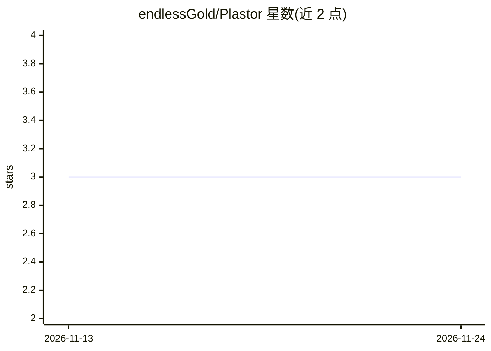

# endlessGold/Plastor

⭐ 3 · Python · MIT · 推送 2026-10-30 · [GitHub](https://github.com/endlessGold/Plastor) · 个人维护

**本地 harness：让 LLM 依三视图图纸生成 3D 生物网格**

用 Rust + Blender + MCP 构建的本地 harness：LLM（如 Claude Code）决定部件与算子，确定性工具负责拟合基元、组装网格并计算全部数值，LLM 不写坐标。通过 MCP 服务器提供 14 个工具，包含验证门槛（仅实际运行的验证器可给出 PASS）、研究决策追踪注册表和 Rust 状态机驱动的分支循环引擎。README 披露当前在手绘真实图纸上仍失败，仅公开副本，真实图纸夹具未发布。MIT 许可，仅 Rust 工具链即可构建运行核心步骤。

## 筛选速览

| 维度 | 判定 | 备注 |
|---|---|---|
| AI 角色 | `ai-ecosystem` | LLM/agent 周边工具 |
| 许可风险 | `permissive` | MIT |
| 部署形态 | `desktop` | 安装包/桌面程序 |
| 模型依赖 | — | README 未给出锁定关系 |
| 硬件要求 | — | 无带数字的原话,不猜 |
| 安装摩擦 | `medium` | 含编译或系统依赖之一 |
| 成熟度 | `idea` | |

## 能力要点

- LLM 决策、工具测量的分工：LLM 不写坐标，数值全部由确定性工具计算
- MCP 服务器提供 14 个工具，验证标准固定在服务器内，同门槛三次 FAIL 后封锁行动工具
- 研究决策注册表（trace/registry.json）与 trace_check/trace_verify 追踪检查
- 分支循环引擎由 Rust 状态机实现，忽略 LLM 自报的判定

## 适用场景

- 根据生物三视图模型图生成 3D 网格资产
- 在低配硬件上运行 LLM 驱动的建模流程
- 为 LLM 长任务建立先定标准、再跑验证器的工作纪律

## 场景标签

 · 领域:3D 建模/LLM 工作流工具

## 证据(README 行号)

> L5: **A free, local harness that lets an LLM (such as Claude Code) work like a skilled 3D modeler — turning creature mod
> L19: Plastor does not try to make the model "smarter". It surrounds the model with the discipline of a skilled modeler:
> L30: - **MCP server** `mh mcp` (stdio JSON-RPC, registered as `plastor` in `.mcp.json`). Its 14 tools cover:

## 星数曲线

2026-11-13 3 → 2026-11-24 3（+0）

---
*卡片 v1 · prompt 1.4 · 生成 2026-11-22 · 置信度 high · 依据 README sha `193901f4f4cf` · [字段定义](../../DATASET.md)*
