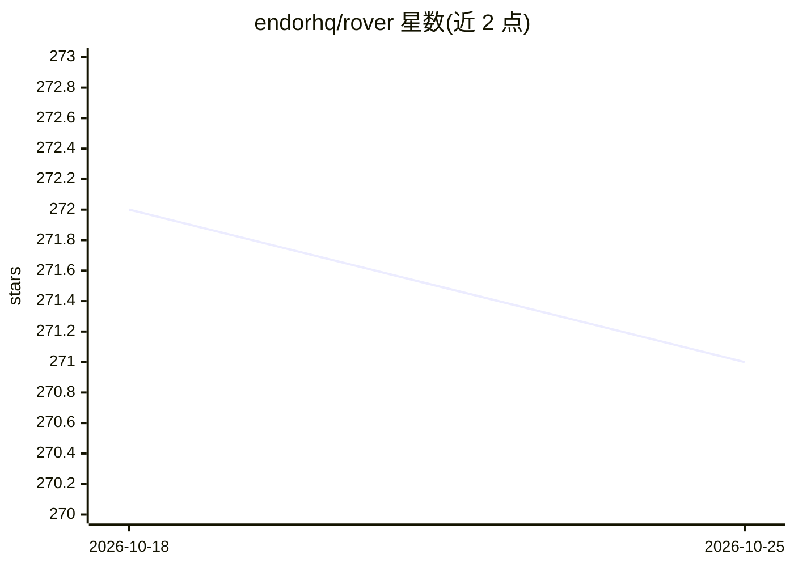

# endorhq/rover

⭐ 271 · TypeScript · Apache-2.0 · 推送 2026-03-27 · [GitHub](https://github.com/endorhq/rover) · [官网](https://endor.dev/rover) · 组织维护

**AI 编码 agent 管理器：让多个 agent 并行隔离地处理编码任务**

Endor 团队开发的 AI 编码 agent 管理工具，支持 Claude Code、Codex、Cursor、Gemini、Qwen 五种 agent。用户以 `rover task` 下发任务，工具自动创建 git worktree 与容器隔离环境，安装配置 agent 并在后台运行工作流直至完成，产出变更文档，可 inspect/iterate/merge/push。附带 VSCode 扩展、MCP server 模式、自定义工作流、容器网络黑白名单、任务生命周期钩子与匿名遥测（可关闭）。限制：依赖 Node.js 22+、Git、Docker/Podman 及至少一个已安装的 agent。

## 筛选速览

| 维度 | 判定 | 备注 |
|---|---|---|
| AI 角色 | `ai-ecosystem` | LLM/agent 周边工具 |
| 许可风险 | `permissive` | Apache-2.0 |
| 部署形态 | `library` | 以包/库形式分发 |
| 模型依赖 | locked-api |  |
| 硬件要求 | — | 无带数字的原话,不猜 |
| 安装摩擦 | `low` | 无编译、无系统依赖或容器化 |
| 成熟度 | — | 结构信号不足 |

## 能力要点

- git worktree + 容器隔离，多任务并行互不干扰
- 支持 5 种 agent 并可 agent:model 语法选模型
- 可运行 MCP server，将核心命令暴露为 MCP 工具
- 容器网络 allowlist/blocklist 与任务生命周期钩子

## 适用场景

- 我同时让多个 AI 编码 agent 处理不同任务而不互相干扰
- 让 agent 在隔离沙箱中改动代码，再审查合并
- 通过 VSCode 扩展或 MCP 管理编码任务

## 场景标签

`编码 Agent` · 领域:编码与开发

## 证据(README 行号)

> L13: Rover is a **manager for AI coding agents that works with Claude Code, Codex, Cursor, Gemini, and Qwen**.
> L15: It helps you get more done, faster, by allowing **multiple agents to work on your codebase simultaneously**. The ag
> L35: - 🔒 Prepare a **local isolated environment** (using containers) with an independent copy of your project code

## 星数曲线

2026-10-18 272 → 2026-10-25 271（-1）

---
*卡片 v1 · prompt 1.4 · 生成 2026-10-22 · 置信度 high · 依据 README sha `51b50fbd64a1` · [字段定义](../../DATASET.md)*
