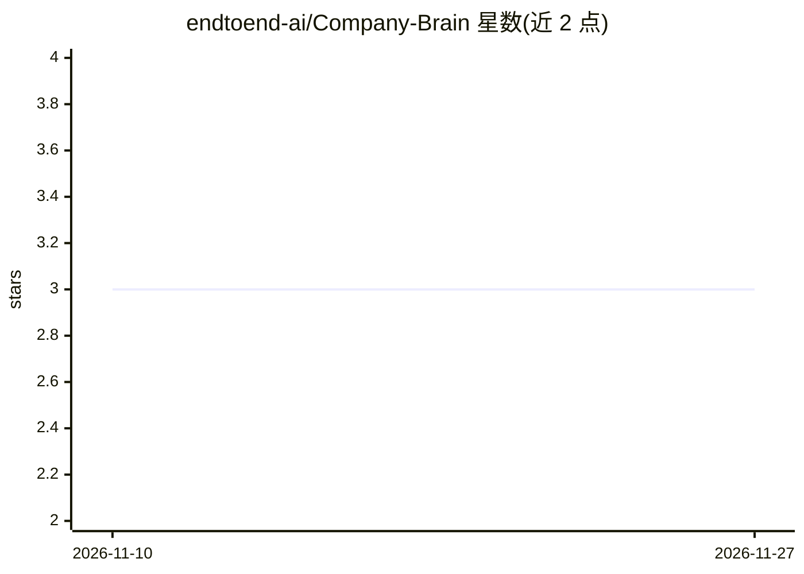

# endtoend-ai/Company-Brain

⭐ 3 · TypeScript · MIT · 推送 2026-11-14 · [GitHub](https://github.com/endtoend-ai/Company-Brain) · [官网](https://aiengstore.com/projects/company-brain) · 个人维护 · 中文 README

**本地优先的企业文档知识工作区：三种检索引擎+带引用问答**

CompanyBrain 是一个 local-first 知识工作区：上传公司文档后，通过三种检索引擎（基于 pgvector+关键词融合的 Naive RAG、基于 LightRAG 实体/关系抽取并存入 PostgreSQL+Apache AGE 的 GraphRAG、页面/分块/事实/类型化链接加 dream 维护的 nano brain）查询并返回带来源引用的答案。附带管理控制台（来源、知识库、用户、模型提供商、检索设置）与检索评测回路（英文 demo 语料、golden 查询集、benchmark harness）。GraphRAG 模块可另起 stdio MCP server，暴露 graph_search 等工具。部署依赖 Bun、Node.js 20+、uv、PostgreSQL 17 及 pgvector/Apache AGE 扩展。

## 筛选速览

| 维度 | 判定 | 备注 |
|---|---|---|
| AI 角色 | `ai-native` | 本体是模型或模型工具 |
| 许可风险 | `permissive` | MIT |
| 部署形态 | `None` |  |
| 模型依赖 | — | README 未给出锁定关系 |
| 硬件要求 | — | 无带数字的原话,不猜 |
| 安装摩擦 | `low` | 无编译、无系统依赖或容器化 |
| 成熟度 | — | 结构信号不足 |

## 能力要点

- 单一工作区集成三种检索引擎：Naive RAG、GraphRAG、Gbrain 式 nano brain
- 每个答案返回所依据的来源证据，界面并排展示文档与图上下文
- 内置检索评测回路：demo 语料、golden 查询集与 benchmark harness
- GraphRAG 模块以 stdio MCP server 形式运行，暴露 graph_search / graph_list_sources / graph_get_document 工具

## 适用场景

- 上传公司内部文档，用带引用的问答检索知识
- 对同一批文档做实体/关系图谱检索
- 在改动检索逻辑前后用 benchmark harness 量化效果
- 通过 MCP 把图谱检索工具接入 agent 会话

## 场景标签

`RAG` `文档问答` `知识图谱` · 领域:知识与检索

## 证据(README 行号)

> L3: CompanyBrain is a local-first knowledge workspace. Upload company material once, then query it
> L58: - **Three retrieval engines in one workspace.** Naive RAG (pgvector embeddings fused with keyword
> L61: - **Cited answers.** Every answer returns the source evidence it was built from, and the workspace

## 星数曲线

2026-11-10 3 → 2026-11-27 3（+0）

---
*卡片 v1 · prompt 1.4 · 生成 2026-11-22 · 置信度 high · 依据 README sha `c1e7823b7b18` · [字段定义](../../DATASET.md)*
