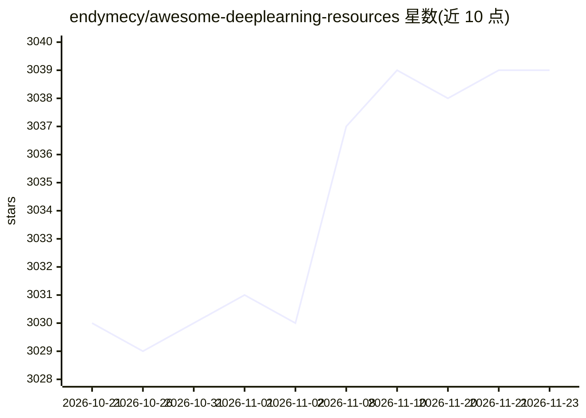

# endymecy/awesome-deeplearning-resources

⭐ 3,039 · MIT · 推送 2026-11-14 · [GitHub](https://github.com/endymecy/awesome-deeplearning-resources) · 个人维护 · 中文 README

**深度学习与强化学习论文及资源清单**

按时间排序收录深度学习与深度强化学习论文的策展清单，覆盖计算机视觉、自然语言处理、多模态等方向，并标注重点条目。除论文外还组织 Model Zoo、预训练模型、课程、书籍、教程、软件框架、应用项目与语料数据集等资源，作者声明会持续更新并添加笔记。以清单形式提供，不含安装与运行环节。

## 筛选速览

| 维度 | 判定 | 备注 |
|---|---|---|
| AI 角色 | `ai-knowledge` | 知识聚合/清单类 |
| 许可风险 | `permissive` | MIT |
| 部署形态 | `None` |  |
| 模型依赖 | — | README 未给出锁定关系 |
| 硬件要求 | — | 无带数字的原话,不猜 |
| 安装摩擦 | `medium` | 含编译或系统依赖之一 |
| 成熟度 | — | 结构信号不足 |

## 能力要点

- 按年份分类的深度学习与深度强化学习论文列表
- Model Zoo 与预训练模型资源汇总
- 覆盖课程、书籍、教程、软件框架与应用项目
- 中英文语料与数据集清单

## 适用场景

- 按方向查找深度学习论文与代码
- 查找入门课程、书籍与教程
- 查找公开语料与数据集

## 场景标签

`精选清单` · 领域:学习与行业

## 证据(README 行号)

> L1: # Awesome Deep learning papers and other resources
> L5: A list of recent papers regarding deep learning and deep reinforcement learning. They are sorted by time to see the 

## 星数曲线

2026-10-21 3,030 → 2026-11-23 3,039（+9）

---
*卡片 v1 · prompt 1.4 · 生成 2026-11-23 · 置信度 high · 依据 README sha `39de555b15c4` · [字段定义](../../DATASET.md)*
