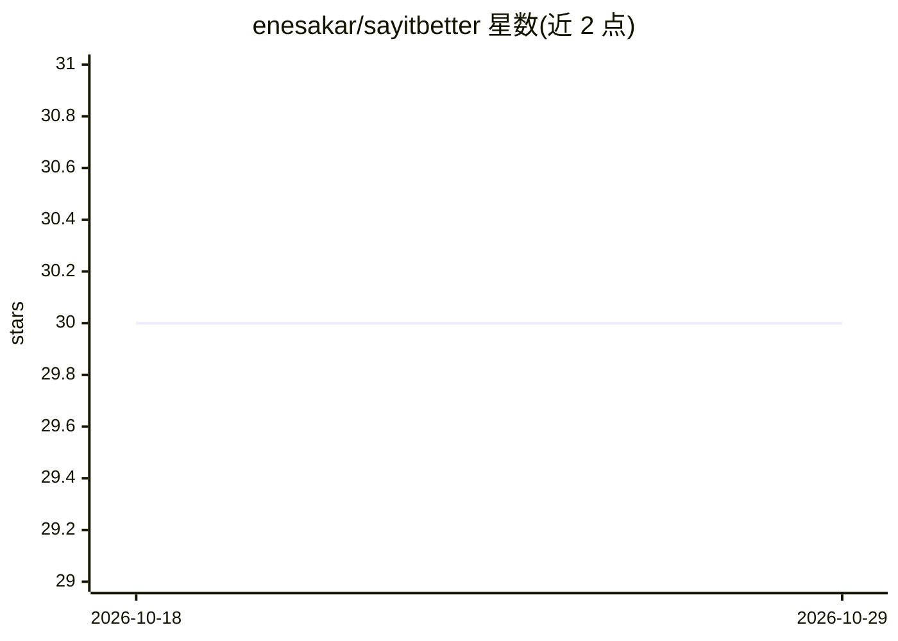

# enesakar/sayitbetter

⭐ 30 · JavaScript · 推送 2026-02-06 · [GitHub](https://github.com/enesakar/sayitbetter) · [官网](https://say-it-better.vercel.app/) · 个人维护

**调用 ChatGPT 改写选中文本的 Chrome 扩展**

Chrome 浏览器扩展：用户选中文本后通过右键菜单调用 ChatGPT（gpt-3.5-turbo）生成改进版本，结果复制到剪贴板，用于改进写作。后端部署在 Vercel Edge，使用 Upstash Redis 做速率限制与缓存。使用方式为安装扩展后在浏览器中选中文本并点击菜单项。README 未提供源码构建或 API key 配置的具体步骤。

## 筛选速览

| 维度 | 判定 | 备注 |
|---|---|---|
| AI 角色 | `ai-native` | 本体是模型或模型工具 |
| 许可风险 | `none` | — |
| 部署形态 | `None` |  |
| 模型依赖 | — | README 未给出锁定关系 |
| 硬件要求 | — | 无带数字的原话,不猜 |
| 安装摩擦 | `low` | 无编译、无系统依赖或容器化 |
| 成熟度 | — | 结构信号不足 |

## 能力要点

- 右键菜单调用 gpt-3.5-turbo 改写选中文本
- 改写结果自动复制到剪贴板
- 后端 Vercel Edge + Upstash Redis 限流与缓存

## 适用场景

- 浏览器中随手改进邮件或帖子的措辞
- 通过 AI 改写示例学习更好的表达方式

## 场景标签

`AI 写作` · 领域:内容生成

## 证据(README 行号)

> L3: A Chrome extension that prompts ChatGPT to enhance the selected text and enhance your writing skills.
> L6: - API: OpenAI `gpt-3.5-turbo`

## 星数曲线

2026-10-18 30 → 2026-10-29 30（+0）

---
*卡片 v1 · prompt 1.4 · 生成 2026-10-26 · 置信度 mid · 依据 README sha `8a7ba8e6722d` · [字段定义](../../DATASET.md)*
