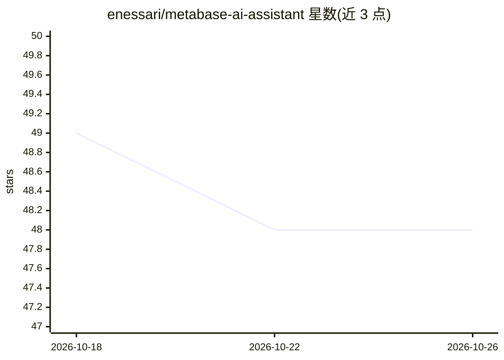

# enessari/metabase-ai-assistant

⭐ 48 · JavaScript · Apache-2.0 · 推送 2026-09-03 · [GitHub](https://github.com/enessari/metabase-ai-assistant) · 个人维护 · 中文 README

**连接 LLM 与 Metabase BI 的 MCP 服务器，提供百余个工具**

面向企业 BI 场景的 Model Context Protocol (MCP) 服务器：将 Claude Desktop、Cursor、VS Code、ChatGPT、Gemini 等 AI 客户端接入 Metabase 实例。提供 143 个分类为 10 个领域的 MCP 工具，覆盖 dbt 语义层扫描与治理、自然语言转 SQL、自愈 SQL 执行（3 轮错误恢复）、看板生成、集合与权限管理、PII 脱敏等。宣称兼容 Metabase v0.43–v0.61+ 的开源与企业版。通过 npx/npm 全局安装，也提供 Smithery、ChatGPT Actions、Cloudflare Workers 部署路径。

## 筛选速览

| 维度 | 判定 | 备注 |
|---|---|---|
| AI 角色 | `ai-ecosystem` | LLM/agent 周边工具 |
| 许可风险 | `permissive` | Apache-2.0 |
| 部署形态 | `library` | 以包/库形式分发 |
| 模型依赖 | locked-api |  |
| 硬件要求 | — | 无带数字的原话,不猜 |
| 安装摩擦 | `low` | 无编译、无系统依赖或容器化 |
| 成熟度 | — | 结构信号不足 |

## 能力要点

- 143 个 MCP 工具，划分 10 个操作领域（SQL 执行/看板/集合/权限等）
- 自治自愈 SQL 引擎：语法纠错、列名 Levenshtein 修正、3 轮错误恢复
- dbt 深度扫描、MetricFlow 集成与治理优先的语义记忆（审批/软归档）
- 实时 PII 脱敏（邮箱/电话/证件号/信用卡/IP/token）

## 适用场景

- 在 Claude 或 Cursor 中用自然语言查询和搭建 Metabase 看板
- 让 AI 助手管理 Metabase 集合、用户与权限
- 基于 dbt 语义层做自然语言数据问答

## 场景标签

`数据分析` · 领域:效率与自动化

## 证据(README 行号)

> L8: Metabase AI Assistant is an enterprise-grade Model Context Protocol (MCP) server that connects Large Language Models
> L23: Metabase AI Assistant transforms standard AI interfaces (Claude Desktop, Cursor, VS Code, ChatGPT, Gemini, automate
> L133: The 143 MCP tools are categorized into 10 operational domains:

## 星数曲线

2026-10-18 49 → 2026-10-26 48（-1）

---
*卡片 v1 · prompt 1.4 · 生成 2026-10-25 · 置信度 high · 依据 README sha `f4accb2577b2` · [字段定义](../../DATASET.md)*
