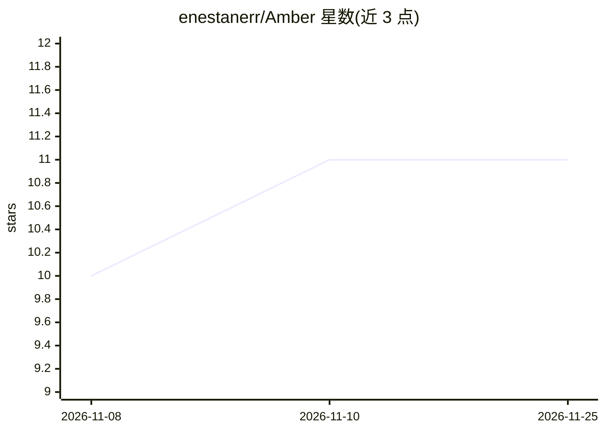

# enestanerr/Amber

⭐ 11 · Python · Apache-2.0 · 推送 2026-11-03 · [GitHub](https://github.com/enestanerr/Amber) · 个人维护

**把重复的 Claude Code 工作流编译成低 token 的 Python 程序**

Amber 围绕 Claude Code 提供一套工作流编译与运维工具：录制 agent 完成任务的若干次运行，经对齐与溯源挖掘后编译为普通 Python 程序——机械步骤用代码、判断步骤保留一个小型 llm() 调用，并从录制生成回放测试与漂移守卫。运行异常时 agent 从失败步骤接管，随后重新编译出下一版本。通过 uv/pipx 以 amber-compiler 安装，需要 Python 3.12+ 与 Claude Code CLI 登录或 ANTHROPIC_API_KEY。支持 record/import/compile/verify/run/doctor/schedule 等子命令及 Claude Code 插件形态。

## 筛选速览

| 维度 | 判定 | 备注 |
|---|---|---|
| AI 角色 | `ai-ecosystem` | LLM/agent 周边工具 |
| 许可风险 | `permissive` | Apache-2.0 |
| 部署形态 | `library` | 以包/库形式分发 |
| 模型依赖 | locked-api |  |
| 硬件要求 | — | 无带数字的原话,不猜 |
| 安装摩擦 | `low` | 无编译、无系统依赖或容器化 |
| 成熟度 | — | 结构信号不足 |

## 能力要点

- 录制 agent 运行并编译为可读、可编辑的 Python 程序
- 守卫停止漂移运行，agent 从失败步骤恢复并重编译
- 支持订阅登录（无 API key）与 Anthropic API 两种后端
- 提供 Claude Code 插件市场与 /amber:compile、/amber:heal 技能

## 适用场景

- 把每周重复执行的多步 agent 任务固定为低 token 的定时程序
- MCP 工具接口变更时自动检测漂移并走 agent 回退
- 用回放测试验证编译后的程序行为是否与录制一致

## 场景标签

 · 领域:LLM 基础设施/agent 工作流工具

## 证据(README 行号)

> L8: Record Claude Code doing a task a few times. Amber compiles the recordings into a readable Python
> L36: - **It is a compiler, not a cache.** Arguments are explained by provenance (an input, an earlier
> L110: Amber talks to Claude in three places, and you choose the model for each:

## 星数曲线

2026-11-08 10 → 2026-11-25 11（+1）

---
*卡片 v1 · prompt 1.4 · 生成 2026-11-18 · 置信度 high · 依据 README sha `854dd9735b9f` · [字段定义](../../DATASET.md)*
