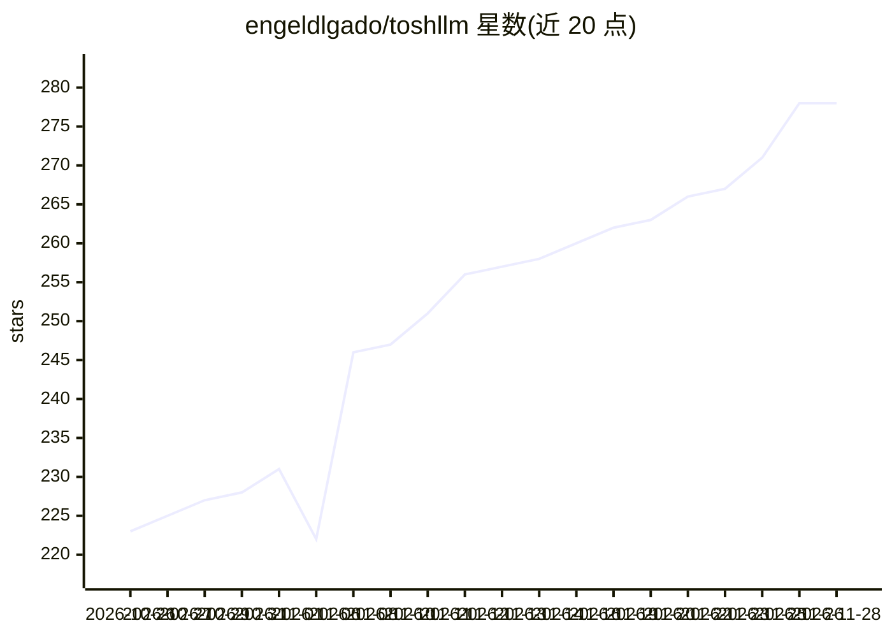

# engeldlgado/toshllm

⭐ 278 · Swift · GPL-3.0 · 推送 2026-11-26 · [GitHub](https://github.com/engeldlgado/toshllm) · [官网](https://toshllm.com) · 个人维护

**在 Intel Mac + AMD GPU 上本地运行大语言模型的 macOS 原生应用**

面向 Intel Mac（含 Hackintosh）配备 AMD 独显用户的本地 LLM 桌面应用：内置打过 AMD 补丁的 llama.cpp 引擎与 Metal 加速，解决官方引擎在此类 GPU 上输出损坏与 PCIe 读取慢的问题。提供原生聊天、Agent 工具与 MCP、Whisper.cpp 转写与字幕、视觉识别、stable-diffusion.cpp 文生图、模型管理与推荐、基准测试、OpenAI 兼容 API 与多 GPU 拆分。以 .dmg 自包含发布，引擎随包内置，无需额外安装依赖；状态为 Beta，GPL-3.0 许可。

## 筛选速览

| 维度 | 判定 | 备注 |
|---|---|---|
| AI 角色 | `ai-ecosystem` | LLM/agent 周边工具 |
| 许可风险 | `viral` | GPL-3.0 |
| 部署形态 | `desktop` | 安装包/桌面程序 |
| 模型依赖 | local-ok | 支持本地模型 |
| 硬件要求 | — | 无带数字的原话,不猜 |
| 安装摩擦 | `low` | 无编译、无系统依赖或容器化 |
| 成熟度 | `idea` | |

## 能力要点

- 打包 AMD 补丁版 llama.cpp，默认启用 AMD Flash Attention 内核
- OpenAI 兼容本地 API 与 Router 模式，支持多模型自动加载
- 内置 Whisper.cpp 转写与 stable-diffusion.cpp 文生图/视频生成（实验性）
- 多 GPU/eGPU 拆分推理与逐配置基准测试

## 适用场景

- 在 Intel Mac 的 AMD 显卡上本地跑大语言模型
- 本地转写录音并生成 SRT/VTT 字幕
- 用 OpenAI 兼容 API 接入本地 RAG 或编码助手客户端
- 无网络环境下进行本地对话、图像生成与数学工具计算

## 场景标签

`推理引擎` `图像生成` `语音识别` `视频生成` · 领域:内容生成

## 证据(README 行号)

> L26: **ToshLLM fixes that.** It bundles `llama.cpp` built with AMD-specific patches and wraps it in a polished native Sw
> L51: - **OpenAI-compatible API** — use it at `http://127.0.0.1:8080`, with optional local-network access and Bonjour dis
> L22: ToshLLM lets you run modern open LLMs **entirely on your own Mac** — your chats never leave the machine, there are 

## 星数曲线

2026-10-26 223 → 2026-11-28 278（+55）

---
*卡片 v1 · prompt 1.4 · 生成 2026-11-26 · 置信度 high · 依据 README sha `78e69d4df4aa` · [字段定义](../../DATASET.md)*
