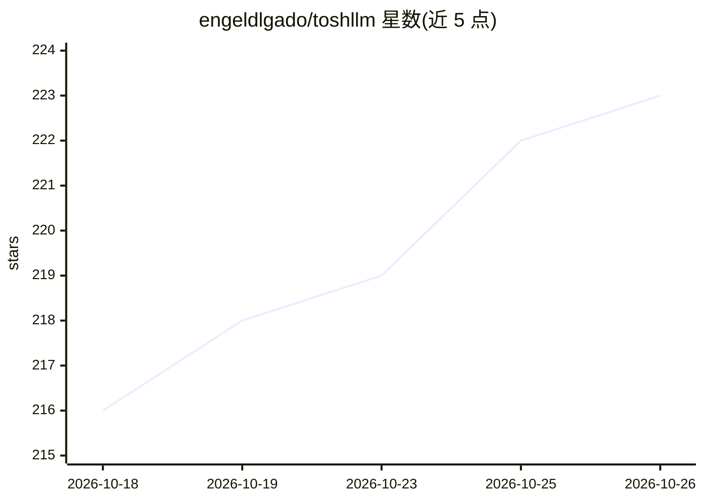

# engeldlgado/toshllm

⭐ 223 · Swift · GPL-3.0 · 推送 2026-10-22 · [GitHub](https://github.com/engeldlgado/toshllm) · [官网](https://toshllm.com) · 个人维护

**在 Intel Mac/AMD GPU 上本地运行 LLM 的原生 macOS 应用**

面向 Intel Mac（含 Hackintosh）与 AMD 独显用户的原生 SwiftUI 应用，捆绑带 AMD 补丁的 llama.cpp，经 Metal 加速在本地运行开源 LLM：原生聊天（多会话、Markdown、文件附件）、Agent 工具与 MCP、可选 SymPy/NumPy/SciPy 数学工具、Whisper.cpp 语音转录、视觉、stable-diffusion.cpp 图像生成（视频生成实验性）。提供按硬件的模型推荐与 VRAM/RAM 估算、基准测试、OpenAI 兼容 API、路由模式、多服务器与多 GPU/eGPU 支持。通过 .dmg 安装，推理引擎随应用捆绑，无需其他依赖。状态标注 Beta。

## 筛选速览

| 维度 | 判定 | 备注 |
|---|---|---|
| AI 角色 | `ai-native` | 本体是模型或模型工具 |
| 许可风险 | `viral` | GPL-3.0 |
| 部署形态 | `desktop` | 安装包/桌面程序 |
| 模型依赖 | local-ok | 支持本地模型 |
| 硬件要求 | — | 无带数字的原话,不猜 |
| 安装摩擦 | `low` | 无编译、无系统依赖或容器化 |
| 成熟度 | `idea` | |

## 能力要点

- 捆绑带 AMD 补丁的 llama.cpp，Metal 加速运行于 AMD dGPU
- Agent 工具与 MCP、SymPy/NumPy/SciPy 数学工具（自带运行时）
- OpenAI 兼容 API、路由模式、多服务器与多 GPU/eGPU
- 模型目录按本机硬件给出 VRAM/RAM 估算与推荐

## 适用场景

- 在带 AMD 显卡的 Intel Mac 上本地跑开源 LLM 聊天
- 给本地 RAG 或编码客户端提供 OpenAI 兼容推理服务
- 用本机 GPU 做语音转录、图像生成与基准测试

## 场景标签

`聊天机器人` `推理引擎` `图像生成` `语音识别` · 领域:对话与助手

## 证据(README 行号)

> L3: **Run large language models locally on Intel Macs with AMD GPUs.**
> L22: ToshLLM lets you run modern open LLMs **entirely on your own Mac** — your chats never leave the machine, there are 
> L26: **ToshLLM fixes that.** It bundles `llama.cpp` built with AMD-specific patches and wraps it in a polished native Sw

## 星数曲线

2026-10-18 216 → 2026-10-26 223（+7）

---
*卡片 v1 · prompt 1.4 · 生成 2026-10-22 · 置信度 high · 依据 README sha `c5afaa68c357` · [字段定义](../../DATASET.md)*
