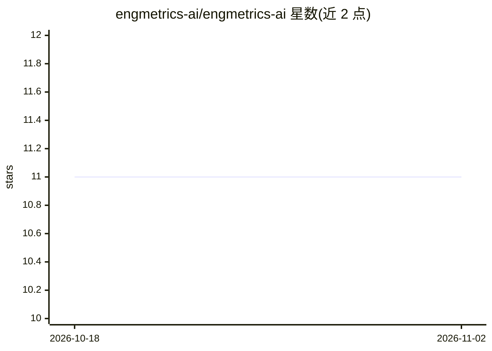

# engmetrics-ai/engmetrics-ai

⭐ 11 · HTML · MIT · 推送 2026-06-16 · [GitHub](https://github.com/engmetrics-ai/engmetrics-ai) · 组织维护

**把 Jira、GitHub 与 AI 用量数据聚合为交付度量看板的 CLI**

Python 3.12+ 的实验性开源 CLI：读取 Jira epic/故事/自定义字段（含 AI token）与经 gh CLI 获取的 GitHub PR 数据，按 PR 标题或分支中的 Jira key 匹配，生成五类度量（DORA、AI 影响、代码质量、流动与返工、风险评分）的本地 HTML 看板及 JSON/CSV 输出。面向 Tech Lead 与工程经理，本地运行、数据不出环境。提供 mock 模式、Docker 与 pipx/源码安装；未发布 PyPI，指标为启发式，声明为实验阶段非生产就绪。

## 筛选速览

| 维度 | 判定 | 备注 |
|---|---|---|
| AI 角色 | `ai-ecosystem` | LLM/agent 周边工具 |
| 许可风险 | `permissive` | MIT |
| 部署形态 | `self-host` | docker 或自建部署 |
| 模型依赖 | — | README 未给出锁定关系 |
| 硬件要求 | — | 无带数字的原话,不猜 |
| 安装摩擦 | `low` | 无编译、无系统依赖或容器化 |
| 成熟度 | `idea` | |

## 能力要点

- Jira+GitHub 数据源经 Jira key 匹配 PR，无需新增埋点
- 五类度量透镜：DORA/AI 影响/代码质量/流动与返工/可解释 0-100 风险分
- 一条命令生成 epic 级本地 HTML 看板与 metrics.json，JSON 设计为可被 LLM/agent 消费
- mock 模式零凭证跑通全流程，Docker 方式无需本机 Python

## 适用场景

- 每个冲刺后生成交付健康周报看板
- 评估团队 AI token 投入与节省工时的关系
- 定位返工成本高的 epic 与评审阻塞点
- 把 EpicReport JSON 交给 AI agent 生成叙述性交付回顾

## 场景标签

`数据分析` · 领域:效率与自动化

## 证据(README 行号)

> L10: > Unifying Jira, GitHub, and AI usage data into actionable delivery insights for Tech Leads and Engineering Manager
> L111: |**AI impact**|Hours saved, token consumption per story point / per hour saved, estimated cost, AI Dependency Risk
> L116: All five lenses are available for any team on Jira + GitHub. AI impact requires

## 星数曲线

2026-10-18 11 → 2026-11-02 11（+0）

---
*卡片 v1 · prompt 1.4 · 生成 2026-11-02 · 置信度 mid · 依据 README sha `fd0d279726dc` · [字段定义](../../DATASET.md)*
