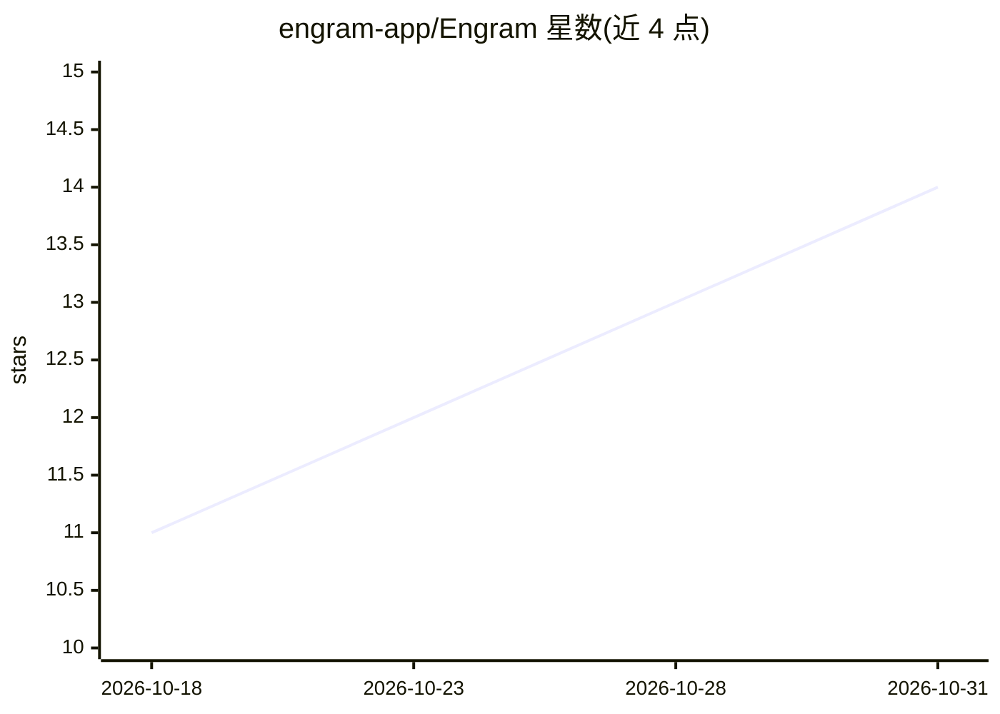

# engram-app/Engram

⭐ 14 · Elixir · NOASSERTION · 推送 2026-10-30 · [GitHub](https://github.com/engram-app/Engram) · [官网](https://engram.page) · 组织维护

**把 Obsidian 笔记变成 AI 记忆的可自托管 MCP 服务器**

用 Elixir/Phoenix 实现的 MCP 服务器，将 Obsidian vault 同步为 AI 助手可读写的 markdown 笔记库，提供语义加关键词混合检索与实时同步。任何 MCP 客户端（Claude Code、Claude.ai、ChatGPT、Cursor、VS Code）可通过托管服务 OAuth 接入，也可用 Docker Compose 自托管；仅暴露 4000 端口，迁移在启动时执行，可选 MinIO 作 S3 附件存储、可切换 Voyage AI 嵌入。项目声明双许可。

## 筛选速览

| 维度 | 判定 | 备注 |
|---|---|---|
| AI 角色 | `ai-ecosystem` | LLM/agent 周边工具 |
| 许可风险 | `none` | NOASSERTION |
| 部署形态 | `self-host` | docker 或自建部署 |
| 模型依赖 | locked-api |  |
| 硬件要求 | — | 无带数字的原话,不猜 |
| 安装摩擦 | `low` | 无编译、无系统依赖或容器化 |
| 成熟度 | — | 结构信号不足 |

## 能力要点

- MCP-native：任意 MCP 客户端可搜索、读取并写入笔记
- Obsidian vault 通过 Engram Sync 插件同步，笔记保持纯 markdown
- Docker Compose 自托管，可选 MinIO 附件存储与 Voyage AI 嵌入
- 提供托管服务 mcp.engram.page（OAuth 登录）

## 适用场景

- 让 Claude/ChatGPT/Cursor 直接检索并续写我的 Obsidian 笔记
- 团队自托管一个统一的 AI 共享记忆后端
- 在多个 AI 客户端间共享同一份知识库

## 场景标签

`知识库管理` `RAG` `Agent 记忆` · 领域:Agent 开发

## 证据(README 行号)

> L3: Engram — your notes are your AI's memory, synced everywhere and read by your AI
> L5: MCP-native · semantic + keyword search · real-time sync · self-hostable · source-available · Elixir/Phoenix
> L23: Nothing to install. Point any MCP client at the hosted server and sign in when

## 星数曲线

2026-10-18 11 → 2026-10-31 14（+3）

---
*卡片 v1 · prompt 1.4 · 生成 2026-10-31 · 置信度 high · 依据 README sha `4b3043f5df7e` · [字段定义](../../DATASET.md)*
