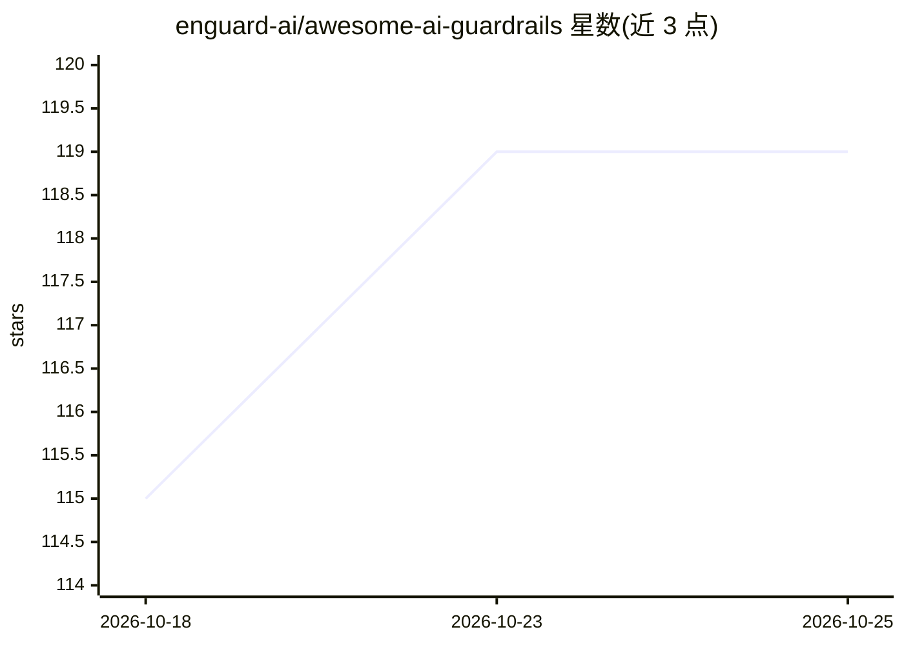

# enguard-ai/awesome-ai-guardrails

⭐ 119 · Python · Apache-2.0 · 推送 2026-07-30 · [GitHub](https://github.com/enguard-ai/awesome-ai-guardrails) · [官网](https://huggingface.co/collections/enguard/) · 组织维护

**AI 防护栏资源策展清单：分类收录模型、工具与数据集**

由 enguard-ai 维护的 AI guardrails 策展清单：按 5 个主类（安全与隐私、响应相关性、语言质量、内容验证、逻辑验证）与若干子类（如 prompt 注入、PII、深伪检测、事实性等）组织，收录约 50 个 HuggingFace 模型条目（含名称、参数规模、任务类型），并按任务类型汇总；另列出开源与闭源的 guardrail 组织/公司（如 Lakera、Guardrails AI Pro、Zenable）及数据集板块。以 MIT License 仓库形式提供，接受 PR 与 issue 贡献。

## 筛选速览

| 维度 | 判定 | 备注 |
|---|---|---|
| AI 角色 | `ai-knowledge` | 知识聚合/清单类 |
| 许可风险 | `permissive` | Apache-2.0 |
| 部署形态 | `None` |  |
| 模型依赖 | — | README 未给出锁定关系 |
| 硬件要求 | — | 无带数字的原话,不猜 |
| 安装摩擦 | `low` | 无编译、无系统依赖或容器化 |
| 成熟度 | — | 结构信号不足 |

## 能力要点

- 5 个主类与 20+ 子类的 guardrail 分类体系
- 按任务类型汇总的模型清单（text/image 分类、生成等）
- 区分开源与闭源的 guardrail 工具与公司条目
- 含数据集板块（正文未完整展示）

## 适用场景

- 为 LLM 应用选型查找防护栏相关模型
- 了解 prompt 注入、PII、深伪检测等方向的可用模型
- 调研开源与商业 guardrail 工具生态

## 场景标签

`精选清单` · 领域:学习与行业

## 证据(README 行号)

> L5: A curated list of awesome AI guardrails.
> L196: ## Organisations/Companies

## 星数曲线

2026-10-18 115 → 2026-10-25 119（+4）

---
*卡片 v1 · prompt 1.4 · 生成 2026-10-23 · 置信度 high · 依据 README sha `09cf7b7c6d8e` · [字段定义](../../DATASET.md)*
