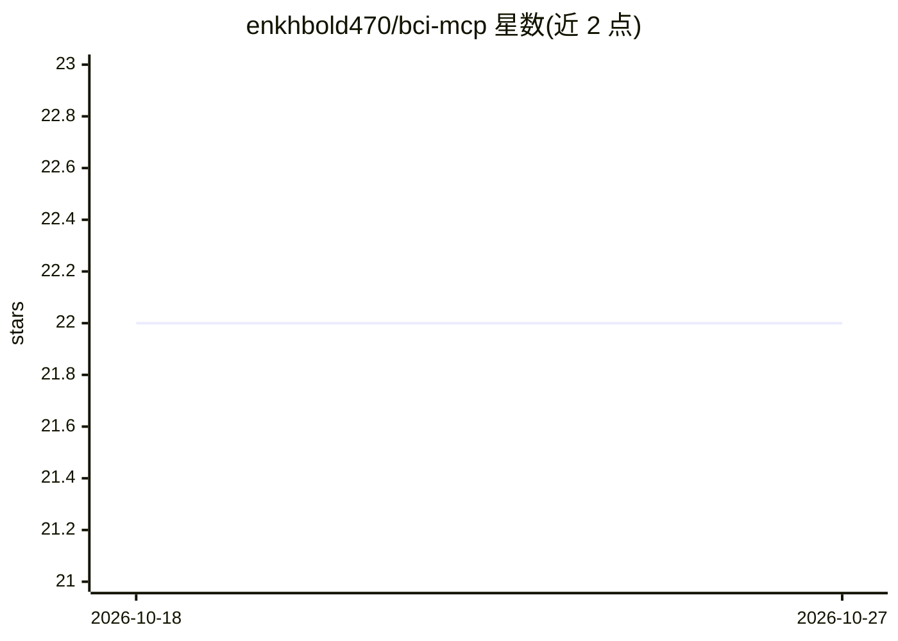

# enkhbold470/bci-mcp

⭐ 22 · Python · MIT · 推送 2026-10-21 · [GitHub](https://github.com/enkhbold470/bci-mcp) · [官网](https://enkhbold470.github.io/bci-mcp/) · 个人维护

**把 EEG 脑状态数据接入 MCP 客户端的脑机接口服务器**

基于 FastMCP 的 Model Context Protocol 服务器，读取 EEG 设备信号（OpenBCI、Muse、NeuroFocus、LSL、串口、录音回放及无硬件的合成源），经 DSP 管线（带通/陷波滤波、Welch 频带功率）计算 focus/calm/attention 等指标与信号质量，通过 14 个 MCP 工具与 3 个资源暴露给 Claude Desktop、Claude Code、Cursor 等 MCP 客户端。供神经反馈、状态感知助手、无障碍交互与研究原型使用。声明非临床、非诊断用途；MCP 通道下仅允许部分设备 URI，回放与串口因文件系统/设备访问风险被拒。

## 筛选速览

| 维度 | 判定 | 备注 |
|---|---|---|
| AI 角色 | `ai-ecosystem` | LLM/agent 周边工具 |
| 许可风险 | `permissive` | MIT |
| 部署形态 | `self-host` | docker 或自建部署 |
| 模型依赖 | locked-api |  |
| 硬件要求 | — | 无带数字的原话,不猜 |
| 安装摩擦 | `low` | 无编译、无系统依赖或容器化 |
| 成熟度 | — | 结构信号不足 |

## 能力要点

- 统一 URI 方案覆盖合成源、OpenBCI/Muse（BrainFlow）、LSL、串口与录音回放
- 14 个 MCP 工具：脑状态读取、频带功率、校准、记录、神经反馈训练等
- 无硬件时可用 synthetic:// 合成设备测试完整 MCP 链路
- 指标为文献频带功率比（如 focus=Pope 1995 engagement index），附引用资源 brain://citations

## 适用场景

- 让 Claude 读取我的专注/放松状态并解释趋势
- 配合 Claude 做有教练讲解的神经反馈训练
- 在购买硬件前用合成设备验证 MCP + DSP 全链路
- 为运动障碍用户构建用工具调用替代点击的交互入口

## 场景标签

 · 领域:脑机接口/生理信号工具

## 证据(README 行号)

> L7: Real Model Context Protocol server for EEG. Python on the backend. Plug into Claude Desktop, Claude Code, or Cursor.
> L258: Stdio server built with FastMCP (official MCP Python SDK).
> L33: You have an EEG signal. This turns it into numbers Claude can read: focus, calm, attention, band powers, signal qua

## 星数曲线

2026-10-18 22 → 2026-10-27 22（+0）

---
*卡片 v1 · prompt 1.4 · 生成 2026-10-27 · 置信度 mid · 依据 README sha `2b2f8e6bccc8` · [字段定义](../../DATASET.md)*
