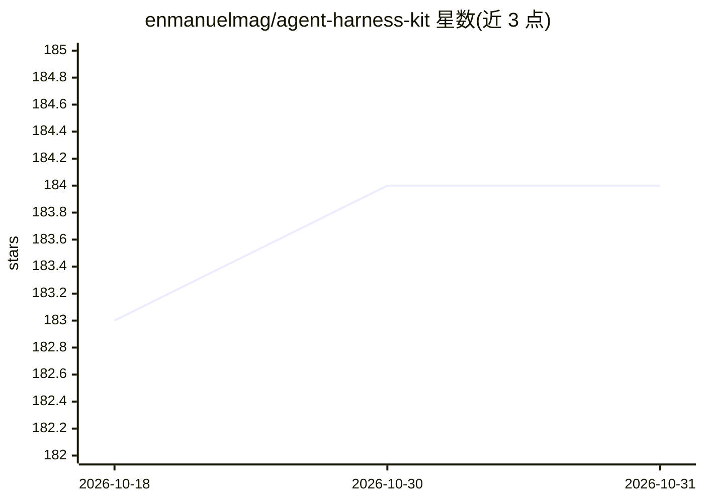

# enmanuelmag/agent-harness-kit

⭐ 184 · TypeScript · Apache-2.0 · 推送 2026-10-30 · [GitHub](https://github.com/enmanuelmag/agent-harness-kit) · [官网](https://stack.cardor.dev/ahk) · 个人维护

**给 AI 编码工具的多 agent 工作流脚手架与任务记录工具**

面向 AI 编码提供商（Claude Code、Codex CLI、Cursor、Grok Build、OpenCode）的 provider 无关脚手架：通过 `ahk init` 生成 MCP 配置与技能文件，在代码库中建立文档（用例/规格）、跟踪任务、角色交接与健康门禁（health gate）机制。MCP 作为任务生命周期数据的 source of truth，任务声明、操作日志、交接与最终健康结果由服务端管理；文档以 Markdown 形式留在 docs/ 目录。提供 `ahk-consultant`、`ahk-triage`、`ahk-spec` 等技能入口，npm/pnpm/bun 全局安装。限制：提示词指令（含 Codex instructions）不构成安全边界；无内置 Jira 连接器。

## 筛选速览

| 维度 | 判定 | 备注 |
|---|---|---|
| AI 角色 | `ai-ecosystem` | LLM/agent 周边工具 |
| 许可风险 | `permissive` | Apache-2.0 |
| 部署形态 | `library` | 以包/库形式分发 |
| 模型依赖 | locked-api |  |
| 硬件要求 | — | 无带数字的原话,不猜 |
| 安装摩擦 | `low` | 无编译、无系统依赖或容器化 |
| 成熟度 | — | 结构信号不足 |

## 能力要点

- MCP 作为任务生命周期数据 source of truth（声明/操作日志/交接/健康结果）
- 支持 Claude Code、Codex CLI、Cursor、Grok Build、OpenCode 五种 provider
- 健康门禁：任务完成前运行健康脚本，失败进入需授权的修复模式
- 规格以 Markdown 文档管理（use-cases/specs），人工显式审批推进

## 适用场景

- 在 AI 编码工具中建立可审计的多角色（lead/explorer/builder/reviewer）工作流
- 用用例→功能规格→技术规格的文档链路管理需求与审批
- 以健康脚本作为任务完成的验证门禁

## 场景标签

`多智能体` `编码 Agent` `Agent 框架` · 领域:Agent 开发

## 证据(README 行号)

> L8: Agent Harness Kit (AHK) gives AI coding providers a shared workflow for documents, tracked tasks, handoffs, and heal
> L73: The lead coordinates the five roles. A reviewer may send bounded feedback back to the builder. MCP owns the task cl
> L121: The stdio server uses the official MCP SDK v2 with a single authored Zod tool registry. Published argument schemas

## 星数曲线

2026-10-18 183 → 2026-10-31 184（+1）

---
*卡片 v1 · prompt 1.4 · 生成 2026-10-23 · 置信度 high · 依据 README sha `3b77bc1d3214` · [字段定义](../../DATASET.md)*
