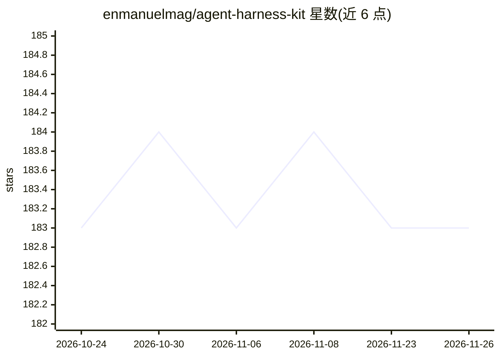

# enmanuelmag/agent-harness-kit

⭐ 183 · TypeScript · Apache-2.0 · 推送 2026-10-30 · [GitHub](https://github.com/enmanuelmag/agent-harness-kit) · [官网](https://stack.cardor.dev/ahk) · 个人维护

**为 AI 编码工具提供多 agent 结构化工作流的脚手架套件**

Agent Harness Kit（AHK）以 npm 包形式发布全局 `ahk` 命令，为 AI 编码 provider（Claude Code、Codex CLI、Cursor、Grok Build、OpenCode 等）提供共享工作流：用例澄清、功能/技术规格、任务认领、交接与健康检查证据。通过 MCP 服务器管理任务状态与动作日志，文档以带日期前缀的 Markdown 存放于 docs 目录；提供 ahk init 初始化、ahk doctor 诊断与数据库延迟观测。README 声明 prompt 指令不是安全边界，权限为工具级控制而非 OS 沙箱。

## 筛选速览

| 维度 | 判定 | 备注 |
|---|---|---|
| AI 角色 | `ai-ecosystem` | LLM/agent 周边工具 |
| 许可风险 | `permissive` | Apache-2.0 |
| 部署形态 | `desktop` | 安装包/桌面程序 |
| 模型依赖 | — | README 未给出锁定关系 |
| 硬件要求 | — | 无带数字的原话,不猜 |
| 安装摩擦 | `low` | 无编译、无系统依赖或容器化 |
| 成熟度 | — | 结构信号不足 |

## 能力要点

- 12 个技能（ahk-spec/ahk-triage/ahk-review 等）覆盖从用例到评审的工作流
- MCP 管理任务认领、动作日志、交接与健康门（health gate）
- 支持 Claude Code/Codex CLI/Cursor/Grok Build/OpenCode 及 OpenCode V2
- 提供 ahk doctor 数据库延迟诊断与 SQLite 历史规模探测

## 适用场景

- 在代码库中给 AI 编码代理建立规格先行、审批后再实现的工作流
- 用健康脚本作为任务完成证据，跟踪多角色交接
- 为团队统一管理 use-case/spec 等规格文档

## 场景标签

`多智能体` `编码 Agent` `Agent 框架` · 领域:Agent 开发

## 证据(README 行号)

> L8: Agent Harness Kit (AHK) gives AI coding providers a shared workflow for documents, tracked tasks, handoffs, and heal
> L73: The lead coordinates the five roles. A reviewer may send bounded feedback back to the builder. MCP owns the task cl

## 星数曲线

2026-10-24 183 → 2026-11-26 183（+0）

---
*卡片 v1 · prompt 1.4 · 生成 2026-11-26 · 置信度 high · 依据 README sha `adb7006a4229` · [字段定义](../../DATASET.md)*
