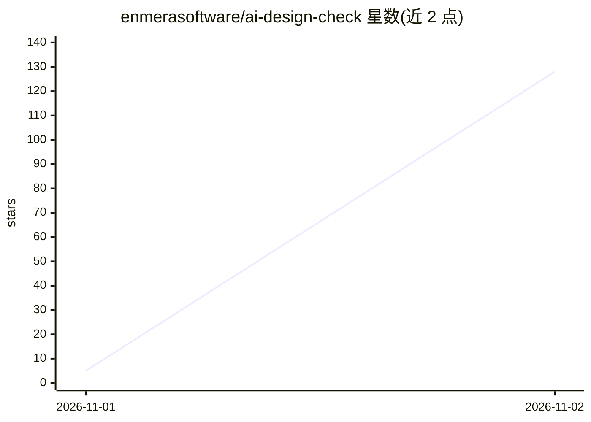

# enmerasoftware/ai-design-check

⭐ 128 · JavaScript · MIT · 推送 2026-11-01 · [GitHub](https://github.com/enmerasoftware/ai-design-check) · [官网](https://www.npmjs.com/package/@enmera/ai-design-check) · 组织维护

**零依赖 UI 设计规则检查器：检测并修复 AI 生成界面的设计问题**

针对 AI 编码代理（Claude Code、Cursor、Codex）生成的界面提供 76 条设计规则与零依赖 Node 检查器，读取 .tsx/.jsx/.vue/.svelte/.html/CSS/i18n JSON 以及 SwiftUI 与 Jetpack Compose 代码，报告规则 ID 与文件行号；附带代理技能在修复后复查并给出前后计数。另含 inventory 组件外观盘点、narrow 手机宽度渲染检查、system 从品牌色生成设计令牌、story 生成前后对比视频。规则来自 Enmera 与 Searvia 实际界面并与 Dribbble/Behance 设计对比归纳，提供英文与土耳其文。

## 筛选速览

| 维度 | 判定 | 备注 |
|---|---|---|
| AI 角色 | `ai-ecosystem` | LLM/agent 周边工具 |
| 许可风险 | `permissive` | MIT |
| 部署形态 | `library` | 以包/库形式分发 |
| 模型依赖 | — | README 未给出锁定关系 |
| 硬件要求 | — | 无带数字的原话,不猜 |
| 安装摩擦 | `medium` | 含编译或系统依赖之一 |
| 成熟度 | — | 结构信号不足 |

## 能力要点

- 76 条设计规则，零依赖 Node 检查器，覆盖 Web 与 SwiftUI/Jetpack Compose
- 无 LLM、无 API key，检测可测缺陷并报告文件与行号
- inventory 盘点组件外观漂移；narrow 以手机宽度渲染检查布局
- system 从品牌色与性格生成设计令牌（CSS/Swift/Kotlin/JSON）

## 适用场景

- AI 代理生成界面后检查并修复设计缺陷
- 清理既有项目中重复的组件外观
- CI 中用 npx 命令拦截新增设计问题
- 为新产品从品牌色生成完整设计系统

## 场景标签

 · 领域:软件开发/设计工具

## 证据(README 行号)

> L7: Finds and fixes what makes interfaces built with AI coding agents (Claude Code, Cursor, Codex) look generated:
> L8: 76 design rules, a zero-dependency checker that marks every finding, and an agent skill that fixes the screen and
> L150: ## For AI coding agents

## 星数曲线

2026-11-01 5 → 2026-11-02 128（+123）

---
*卡片 v1 · prompt 1.4 · 生成 2026-11-02 · 置信度 high · 依据 README sha `862106b4ae59` · [字段定义](../../DATASET.md)*
