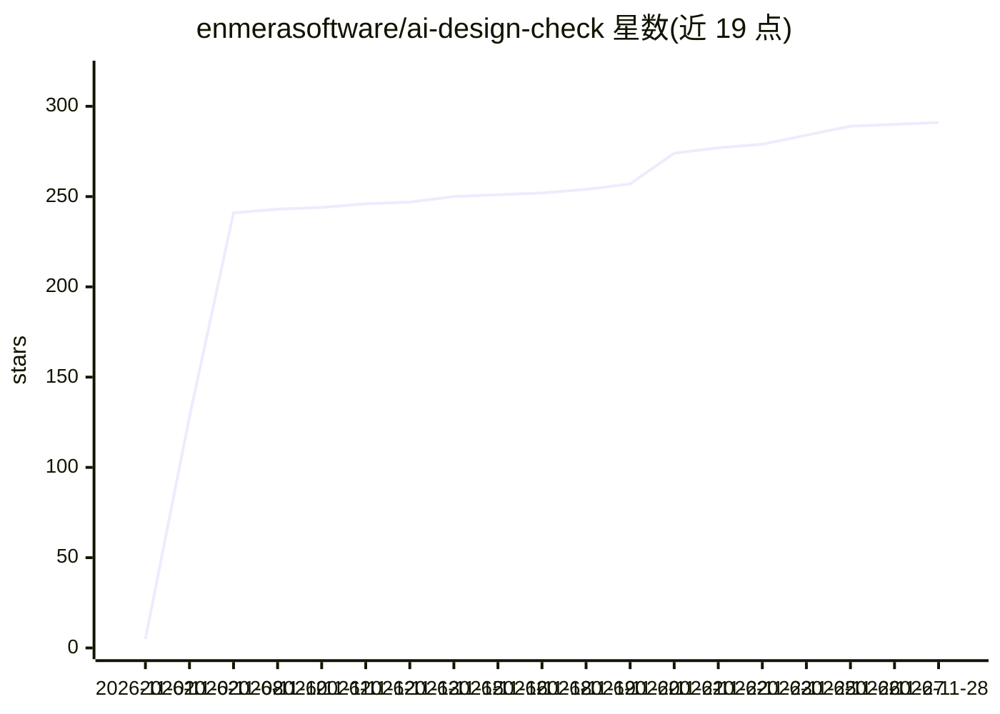

# enmerasoftware/ai-design-check

⭐ 291 · HTML · MIT · 推送 2026-11-24 · [GitHub](https://github.com/enmerasoftware/ai-design-check) · [官网](https://www.npmjs.com/package/@enmera/ai-design-check) · 组织维护

**检测并修复 AI 生成界面痕迹的开发者检查工具**

提供 147 条界面设计规则与零依赖、无 API key 的检查器，读取 Web 项目（React/Vue/Svelte/Laravel Blade/HTML，Tailwind/Bootstrap/纯 CSS）及 SwiftUI、Jetpack Compose、Flutter、React Native 应用，输出无障碍、排版、布局、文案等问题清单；机械性修复可由 --fix 直接完成，其余通过安装为 agent skill 交由 Claude Code 或 Codex 修复。redesign 子命令调用 agent 生成重设计卡片并在 git 分支上逐 pass 应用，图像生成需 OPENAI/GEMINI key 且逐张确认。文档提供英文与土耳其语。

## 筛选速览

| 维度 | 判定 | 备注 |
|---|---|---|
| AI 角色 | `ai-ecosystem` | LLM/agent 周边工具 |
| 许可风险 | `permissive` | MIT |
| 部署形态 | `library` | 以包/库形式分发 |
| 模型依赖 | — | README 未给出锁定关系 |
| 硬件要求 | — | 无带数字的原话,不猜 |
| 安装摩擦 | `medium` | 含编译或系统依赖之一 |
| 成熟度 | — | 结构信号不足 |

## 能力要点

- 147 条规则，检查器零依赖、无 API key，规则文档提供英文与土耳其语
- 68 条规则读代码、61 条读运行页面（scan），33 条标记为 review 留给人工
- scan/redesign/inventory/narrow/system/story 等多个子命令
- redesign 在新 git 分支逐 pass 应用修复，丢失内容的 pass 被丢弃

## 适用场景

- 检查用 AI 编码代理构建的前端界面是否存在生成痕迹
- 对 AI 生成的页面做无障碍与移动端适配排查
- 让 agent 批量修复界面设计问题并前后对比
- 统计项目内按钮、输入框、标题等组件数量

## 场景标签

`代码审查` · 领域:编码与开发

## 证据(README 行号)

> L9: For anyone building with Claude Code, Cursor or Codex: 147 design rules, a checker with no dependencies and no API k
> L115: `redesign` is the one part that needs your agent (Claude Code or Codex), because deciding what a page should show 
> L66: 68 rules read your code (34 of them in app code too) and 61 read the running page (`scan`), some of them both. The 

## 星数曲线

2026-11-01 5 → 2026-11-28 291（+286）

---
*卡片 v1 · prompt 1.4 · 生成 2026-11-25 · 置信度 high · 依据 README sha `059ff43543e2` · [字段定义](../../DATASET.md)*
