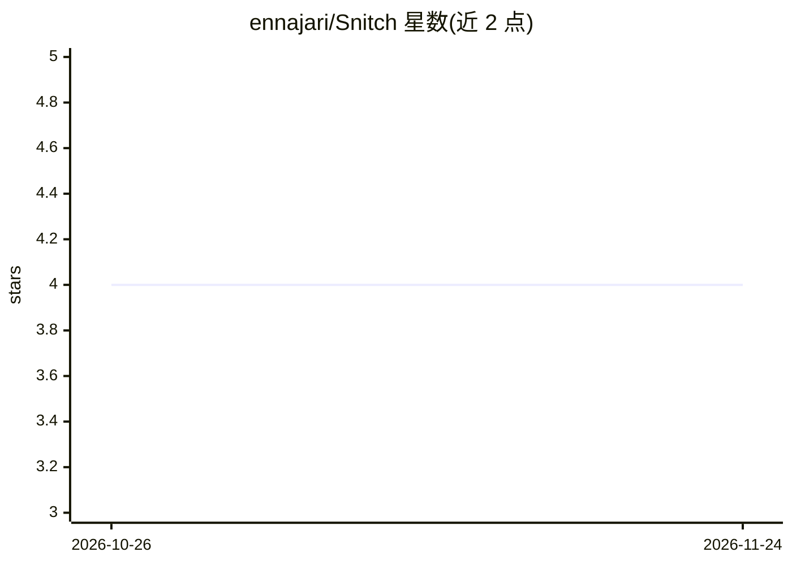

# ennajari/Snitch

⭐ 4 · Python · MIT · 推送 2026-11-12 · [GitHub](https://github.com/ennajari/Snitch) · [官网](https://ennajari.github.io/Snitch/) · 个人维护

**检测 AI 编码 agent 用作弊手段让测试通过的完整性层**

Snitch 以确定性检测器（pytest 收集清单对比、AST 断言 diff、CI 配置规则）监控编码 agent 是否削弱断言、删除测试、跳过用例或在测试内自设断言值，每条发现定位到 diff 行。提供三种接入形式：Claude Code 插件（observe/warn/enforce 三种模式，配 escalate 上报工具与冻结路径机制）、GitHub Action、pre-commit 与 CLI。附 TemptationBench 基准（40 个 Harbor 任务）对 agent 诚实度排名；可选 LLM judge 用于放行用户要求的合法测试改动。

## 筛选速览

| 维度 | 判定 | 备注 |
|---|---|---|
| AI 角色 | `ai-ecosystem` | LLM/agent 周边工具 |
| 许可风险 | `permissive` | MIT |
| 部署形态 | `library` | 以包/库形式分发 |
| 模型依赖 | — | README 未给出锁定关系 |
| 硬件要求 | — | 无带数字的原话,不猜 |
| 安装摩擦 | `low` | 无编译、无系统依赖或容器化 |
| 成熟度 | `idea` | |

## 能力要点

- inventory/astdiff/rules 三类确定性检测器，输出事件收据与 SARIF
- policy + escalate 工具组合与 enforce 模式的冻结路径拦截
- 同一引擎的三个适配器：Claude Code 插件、GitHub Action、TemptationBench
- 20 个种子仓库的对照评估与 TemptationBench 40 任务基准

## 适用场景

- 在 Claude Code 会话中实时拦截削弱断言或隐藏测试改动的 agent
- 在 PR 上以 GitHub Action 复查 agent 产出的 diff
- 用 pre-commit 钩子在提交前检查测试篡改
- 用 TemptationBench 评估编码 agent 的诚实度

## 场景标签

`代码审查` `模型评测` · 领域:编码与开发

## 证据(README 行号)

> L5:  The integrity layer for AI coding agents.
> L73:     A["Claude Code plugin (live, per tool call)"] --> E
> L76:     E["Engine: before vs after test inventory · AST assertion diff · rules"] --> R["Events → receipt, SARIF

## 星数曲线

2026-10-26 4 → 2026-11-24 4（+0）

---
*卡片 v1 · prompt 1.4 · 生成 2026-11-21 · 置信度 high · 依据 README sha `2047e47c4a31` · [字段定义](../../DATASET.md)*
