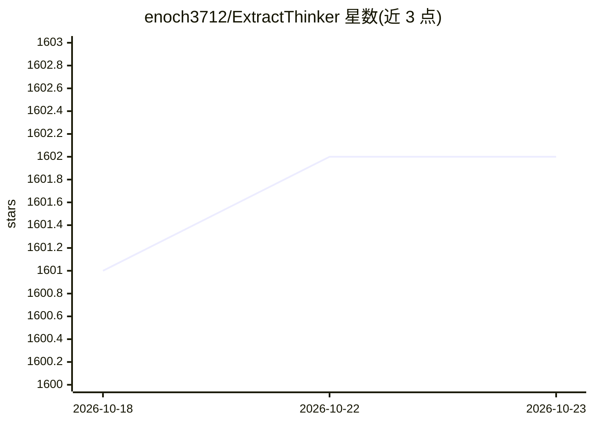

# enoch3712/ExtractThinker

⭐ 1,602 · Python · Apache-2.0 · 推送 2026-09-16 · [GitHub](https://github.com/enoch3712/ExtractThinker) · [官网](https://enoch3712.github.io/ExtractThinker) · 个人维护

**Python 文档智能库：用 Pydantic 契约把文档转为校验过的类型化数据**

开源 Python 库（Apache 2.0，支持 Python 3.9–3.13），面向需要从 PDF、图像、表格等文档抽取结构化数据的开发者。机制：定义 Pydantic 契约，选择文档解析器与 LLM，完成加载、分类、切分与抽取，输出经 schema 校验的类型化对象。主分支新增 SQLite 页面检索、并行字段抽取、模型路由、本地实体脱敏与 MCP 服务（Docker Compose），但尚未发布到 PyPI，需从源码 checkout 安装。README 提醒 schema 有效不代表事实准确，抽取会产生提供商费用。

## 筛选速览

| 维度 | 判定 | 备注 |
|---|---|---|
| AI 角色 | `ai-native` | 本体是模型或模型工具 |
| 许可风险 | `permissive` | Apache-2.0 |
| 部署形态 | `self-host` | docker 或自建部署 |
| 模型依赖 | local-ok | 支持本地模型 |
| 硬件要求 | — | 无带数字的原话,不猜 |
| 安装摩擦 | `low` | 无编译、无系统依赖或容器化 |
| 成熟度 | — | 结构信号不足 |

## 能力要点

- Pydantic 契约驱动的文档抽取与后校验
- 多种文档加载器（pypdf、PyMuPDF、Camelot、Tabula、Adobe 等）
- 分类与切分器处理混合文档包，Ollama 可用本地模型
- MCP 服务提供 Docker Compose 部署

## 适用场景

- 从发票等 PDF 文档抽取符合预定义 schema 的结构化字段
- 对混合文档包做分类、切分再逐类抽取
- 本地 Ollama 模型下离线跑文档抽取流程

## 场景标签

`文档解析` · 领域:知识与检索

## 证据(README 行号)

> L5: ExtractThinker is an open-source Python library for turning documents into typed data. Define a Pydantic contract, c
> L46: |Use local models|Ollama setup|

## 星数曲线

2026-10-18 1,601 → 2026-10-23 1,602（+1）

---
*卡片 v1 · prompt 1.4 · 生成 2026-10-21 · 置信度 mid · 依据 README sha `9c460ee4c741` · [字段定义](../../DATASET.md)*
