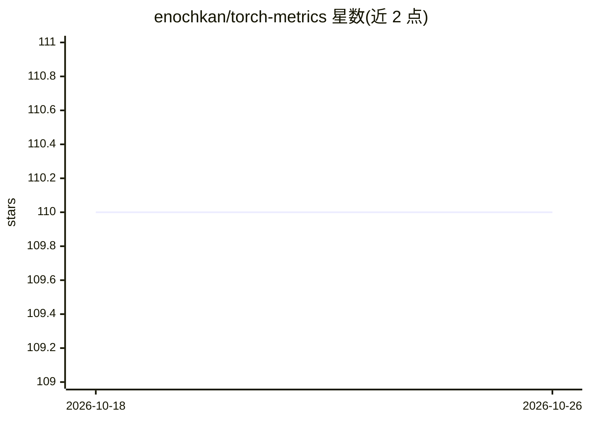

# enochkan/torch-metrics

⭐ 110 · Python · MIT · 推送 2026-10-16 · [GitHub](https://github.com/enochkan/torch-metrics) · 个人维护

**PyTorch 模型评估指标库：提供常见 ML 度量类**

面向 PyTorch 用户的自定义评估指标库，功能对标 tf.keras.metrics，提供 Accuracy、Precision、Recall、F1Score、MeanIoU、DSC、KLDivergence 等指标类，以类似方式在训练/评估循环中实例化并调用。README 提及该库起因于 PyTorch 缺少内置 torch.metrics。以 pip 安装的 Python 包形式提供，仓库含 make develop 本地开发、pytest 测试与 pre-commit 配置。CosineSimilarity、AUC、交叉熵等指标列于待办清单。

## 筛选速览

| 维度 | 判定 | 备注 |
|---|---|---|
| AI 角色 | `ai-ecosystem` | LLM/agent 周边工具 |
| 许可风险 | `permissive` | MIT |
| 部署形态 | `library` | 以包/库形式分发 |
| 模型依赖 | — | README 未给出锁定关系 |
| 硬件要求 | — | 无带数字的原话,不猜 |
| 安装摩擦 | `low` | 无编译、无系统依赖或容器化 |
| 成熟度 | — | 结构信号不足 |

## 能力要点

- 提供 MSE/RMSE/MAE、Precision/Recall、F1Score、MeanIoU、DSC、KLDivergence 等 14 个已实现指标类
- 对标 tf.keras.metrics 的 PyTorch 指标库
- 提供 make develop、pytest 与 pre-commit 的本地开发流程

## 适用场景

- 在 PyTorch 训练与评估流程中计算常用指标
- 复用 Keras 风格的指标接口进行模型评估

## 场景标签

`模型评测` · 领域:评测与运维

## 证据(README 行号)

> L6: Model evaluation metrics for PyTorch
> L8: Torch-metrics serves as a custom library to provide common ML evaluation metrics in Pytorch, similar to `tf.keras.me

## 星数曲线

2026-10-18 110 → 2026-10-26 110（+0）

---
*卡片 v1 · prompt 1.4 · 生成 2026-10-23 · 置信度 high · 依据 README sha `c043124ad4b2` · [字段定义](../../DATASET.md)*
