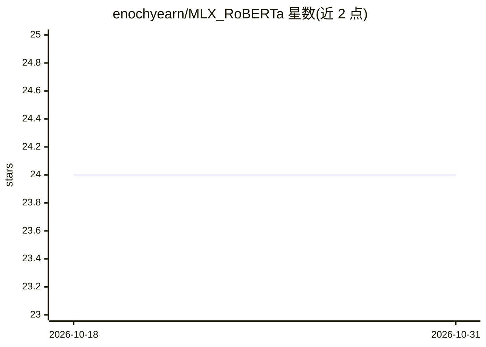

# enochyearn/MLX_RoBERTa

⭐ 24 · Python · MIT · 推送 2026-02-22 · [GitHub](https://github.com/enochyearn/MLX_RoBERTa) · 个人维护

**MLX 实现的 RoBERTa 问答模型，可导出 Core ML**

在 Apple MLX 框架上实现 RoBERTa 抽取式问答：通过 convert.py 借助 HuggingFace transformers 下载权重（默认 deepset/roberta-base-squad2）并转换为 MLX 的 .npz 格式；提供 RobertaForQuestionAnswering 类与 load_qa/run_qa 接口供代码集成。另含 export_roberta_qa_coreml.py，将模型经 TorchScript 追踪转换为 Core ML mlpackage（支持 fp16/fp32、固定或可变序列长度），并在 macOS 上做数值一致性检查。训练与预训练能力尚未实现，列于 To Dos。

## 筛选速览

| 维度 | 判定 | 备注 |
|---|---|---|
| AI 角色 | `ai-native` | 本体是模型或模型工具 |
| 许可风险 | `permissive` | MIT |
| 部署形态 | `None` |  |
| 模型依赖 | — | README 未给出锁定关系 |
| 硬件要求 | — | 无带数字的原话,不猜 |
| 安装摩擦 | `low` | 无编译、无系统依赖或容器化 |
| 成熟度 | — | 结构信号不足 |

## 能力要点

- convert.py 将 HuggingFace RoBERTa 权重转换为 MLX .npz 格式
- 提供 RobertaForQuestionAnswering 加载与 run_qa 推理接口
- 导出 Core ML mlpackage，支持 fp16/fp32 与可变长度输入，含数值一致性检查

## 适用场景

- 在 Apple Silicon 上用 MLX 运行 RoBERTa 抽取式问答
- 把 RoBERTa QA 模型导出为 Core ML 供 iOS/macOS 应用使用

## 场景标签

`推理引擎` · 领域:训练与推理

## 证据(README 行号)

> L1: # RoBERTa: A Robustly Optimized BERT Pretraining in MLX
> L3: An implementation of Roberta Question Answering using MLX.

## 星数曲线

2026-10-18 24 → 2026-10-31 24（+0）

---
*卡片 v1 · prompt 1.4 · 生成 2026-10-27 · 置信度 high · 依据 README sha `104fd1de14d5` · [字段定义](../../DATASET.md)*
