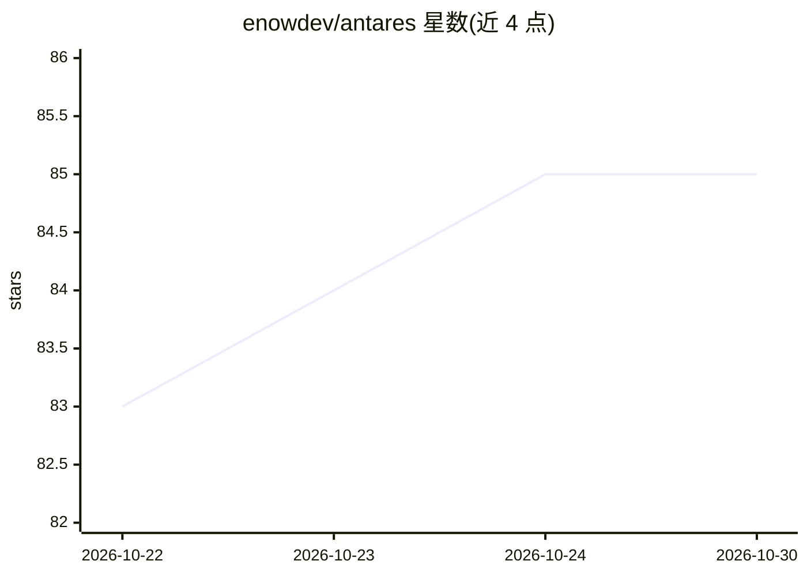

# enowdev/antares

⭐ 85 · Go · Apache-2.0 · 推送 2026-10-15 · [GitHub](https://github.com/enowdev/antares) · [官网](https://antares.enowx.ai) · 组织维护

**自托管单二进制 AI 渗透测试 agent 与助手**

Go 后端、React 面板与终端 UI 打包为单一二进制的自托管 AI agent：内置 13 个专家角色（含授权渗透测试角色），内置 7,000+ 测试流程，可对 Web 应用按 OWASP 测试并生成报告。agent 具备文件读写、持久 shell、DevTools 协议驱动的真实 Chromium、指纹化 HTTP、长期记忆与原生 RAG（FTS5/tsvector + HNSW）。支持 Telegram/Discord 网关与 MCP 技能目录。面向安全测试人员与需要自托管模型（本地或自有 API key）的用户；README 自称早期版本。

## 筛选速览

| 维度 | 判定 | 备注 |
|---|---|---|
| AI 角色 | `ai-native` | 本体是模型或模型工具 |
| 许可风险 | `permissive` | Apache-2.0 |
| 部署形态 | `None` |  |
| 模型依赖 | local-ok | 支持本地模型 |
| 硬件要求 | — | 无带数字的原话,不猜 |
| 安装摩擦 | `medium` | 含编译或系统依赖之一 |
| 成熟度 | `idea` | |

## 能力要点

- 单二进制自托管，Go 后端+内嵌面板+终端 UI，Linux/macOS/Windows 桌面应用
- 内置 7,000+ 渗透测试流程，按授权范围（scope）门控的安全专家角色
- 真实 Chromium（DevTools 协议）+ 指纹化 HTTP（JA3/JA4）+ 长期记忆 + 原生 RAG
- 任何 OpenAI 兼容端点可用，Anthropic/Gemini 有原生适配器

## 适用场景

- 对授权目标执行渗透测试并自动生成证据与报告
- 通过 Web/终端/Telegram/Discord 使用自托管模型的通用 AI 助手
- 在自有机器上运行带浏览器、shell 与记忆的 agent 工作台

## 场景标签

`网络安全` `AI 助手` `浏览器自动化` · 领域:效率与自动化

## 证据(README 行号)

> L28: - **Authorized penetration testing.** Point it at a target you may test:
> L31:  Over 7,000 testing procedures ship inside the binary; nothing exploitative,
> L33: - **Everything an agent needs.** Reads and writes files, runs your shell,

## 星数曲线

2026-10-22 83 → 2026-10-30 85（+2）

---
*卡片 v1 · prompt 1.4 · 生成 2026-10-24 · 置信度 high · 依据 README sha `f930f06a624a` · [字段定义](../../DATASET.md)*
