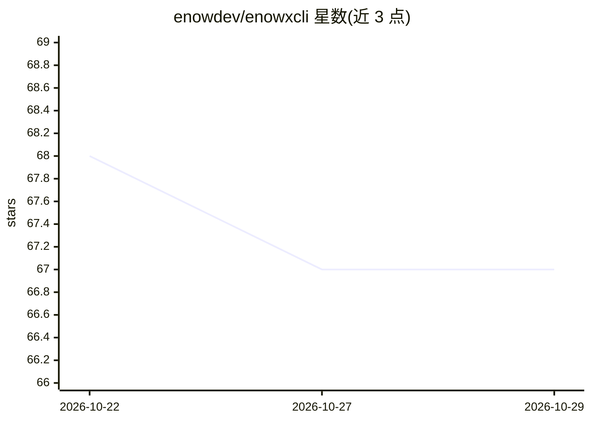

# enowdev/enowxcli

⭐ 67 · Rust · Apache-2.0 · 推送 2026-10-05 · [GitHub](https://github.com/enowdev/enowxcli) · [官网](https://enowx.ai) · 组织维护

**终端多智能体 AI 编程助手，单一二进制**

Rust 编写的终端 AI 编程代理：任务由 Orchestrator/Writer/Researcher 三种角色与 BUILD/SECURITY/SUPPORT 分组的专业 agent 协作完成，agent 之间相互评审。支持任意 OpenAI 兼容端点，内置 enxapi、OpenAI、OpenRouter、Groq、DeepSeek 提供商，各 agent 可指定不同模型。内置按语法切分的项目 RAG 代码搜索，以及 coolify/dokploy/vps/rag 四个 MCP 服务器。提供 macOS/Linux/Windows 预编译二进制（x86_64 与 ARM64），也可 cargo 源码安装。README 声明为早期版本（v0.1.0 首个公开构建）。

## 筛选速览

| 维度 | 判定 | 备注 |
|---|---|---|
| AI 角色 | `ai-native` | 本体是模型或模型工具 |
| 许可风险 | `permissive` | Apache-2.0 |
| 部署形态 | `desktop` | 安装包/桌面程序 |
| 模型依赖 | locked-api |  |
| 硬件要求 | — | 无带数字的原话,不猜 |
| 安装摩擦 | `medium` | 含编译或系统依赖之一 |
| 成熟度 | `idea` | |

## 能力要点

- 多专业 agent 分工协作并相互评审（计划/构建/审查/测试）
- 内置 RAG 代码搜索，按代码语法切分索引
- 任意 OpenAI 兼容端点接入，每个 agent 可用不同模型
- 内置 4 个 MCP 服务器（coolify/dokploy/vps/rag），由自身二进制提供

## 适用场景

- 在终端里让一组 AI agent 规划、实现并测试代码任务
- 对已授权目标执行安全评估（含 13 个安全专项 agent）
- 通过 SSH/VPS MCP 服务器在对话中管理部署与服务器

## 场景标签

`多智能体` `编码 Agent` `网络安全` · 领域:Agent 开发

## 证据(README 行号)

> L31: - **A team, not one model.** It splits a task across specialist agents (plan,
> L34: - **Any provider, no lock-in.** Bring any OpenAI-compatible endpoint, including
> L40: - **One binary.** Written in Rust, no runtime to install. Runs on macOS, Linux

## 星数曲线

2026-10-22 68 → 2026-10-29 67（-1）

---
*卡片 v1 · prompt 1.4 · 生成 2026-10-24 · 置信度 mid · 依据 README sha `8b1dd5bdc016` · [字段定义](../../DATASET.md)*
