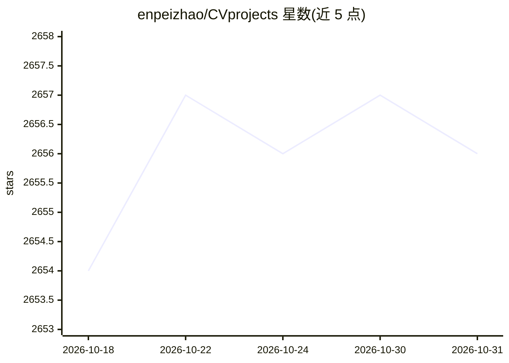

# enpeizhao/CVprojects

⭐ 2,656 · Jupyter Notebook · 推送 2025-12-26 · [GitHub](https://github.com/enpeizhao/CVprojects) · 个人维护 · 中文 README

**计算机视觉项目代码合集：检测识别分割等几十个实例**

个人维护的计算机视觉项目聚合仓库，收录约数十个带代码的实例项目，覆盖目标检测（YOLO 系列、旋转目标检测）、跟踪（DeepSort）、分割（UNet、Swin-Transformer、SAM）、人脸识别（facenet、ReID）、OCR 车牌识别、动作识别、GAN 人脸编辑、以图搜图等，语言以 Python/C++ 为主，并包含嵌入式与机械臂类硬件结合项目（树莓派、Jetson Nano、K210、ROS2 机械臂、Realsense+Dobot）。以项目清单表格组织，部分条目给出代码目录路径，供学习者按例取用。

## 筛选速览

| 维度 | 判定 | 备注 |
|---|---|---|
| AI 角色 | `ai-knowledge` | 知识聚合/清单类 |
| 许可风险 | `none` | — |
| 部署形态 | `None` |  |
| 模型依赖 | — | README 未给出锁定关系 |
| 硬件要求 | — | 无带数字的原话,不猜 |
| 安装摩擦 | `low` | 无编译、无系统依赖或容器化 |
| 成熟度 | — | 结构信号不足 |

## 能力要点

- 覆盖检测、跟踪、分割、人脸识别、OCR、动作识别等方向的数十个项目实例
- 含 C++ TensorRT/DeepStream 多流检测追踪工程
- 包含嵌入式与机械臂结合项目（树莓派、Jetson Nano、K210、ROS2、Dobot）
- 以表格清单组织，逐条给出代码目录路径

## 适用场景

- 学习各类 CV 任务的完整可运行代码
- 查找嵌入式设备（树莓派/Jetson）上部署检测模型的参考
- 复现机械臂视觉抓取、ReID 搜人等软硬件结合项目

## 场景标签

`人脸识别` `目标检测` `OCR` `图像视频处理` · 领域:感知与多模态

## 证据(README 行号)

> L14: ### 2. Projects list
> L23: ### 3. Archived

## 星数曲线

2026-10-18 2,654 → 2026-10-31 2,656（+2）

---
*卡片 v1 · prompt 1.4 · 生成 2026-10-21 · 置信度 high · 依据 README sha `fe6d68dbd6a0` · [字段定义](../../DATASET.md)*
