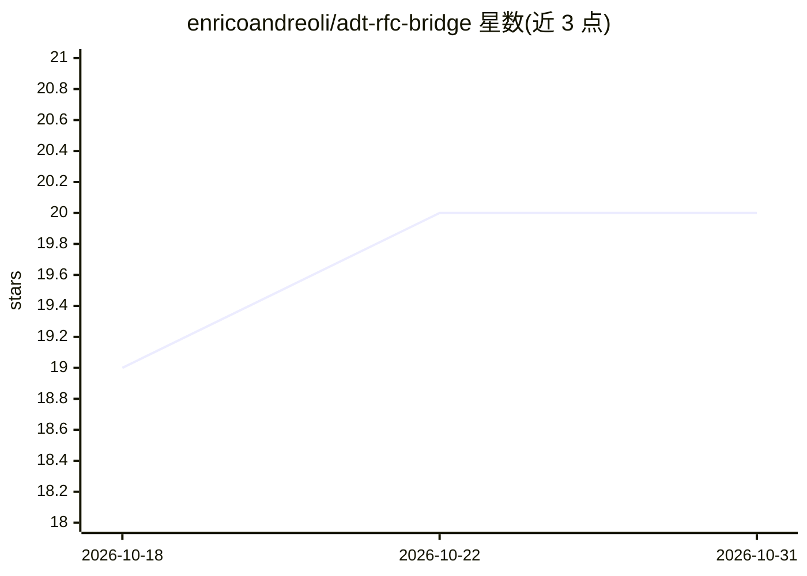

# enricoandreoli/adt-rfc-bridge

⭐ 20 · Python · MIT · 推送 2026-09-10 · [GitHub](https://github.com/enricoandreoli/adt-rfc-bridge) · 个人维护

**让 HTTP-only ADT 客户端经 RFC 隧道访问 SAP 的本地桥接服务**

本地 HTTP 服务器，接收 ADT REST 请求后通过 PyRFC 调用 SADT_REST_RFC_ENDPOINT 函数模块转发到仅可经 SAProuter RFC 访问的 SAP 系统，使 vsp 等 HTTP-only ADT 客户端（含 Claude 的 ABAP 开发 MCP 服务）能够读取、搜索和编辑 ABAP 代码。处理 HEAD→GET、合成 CSRF token，但受限于无状态调用，无法驱动对象激活等多请求有状态流程；附带 adt_write.py、adt_https_write.py、rpy_put_report.py 辅助脚本。面向 SAP 开发者与 AI 编码客户端使用者，需 SAP NW RFC SDK（x64）与 pyrfc。

## 筛选速览

| 维度 | 判定 | 备注 |
|---|---|---|
| AI 角色 | `ai-ecosystem` | LLM/agent 周边工具 |
| 许可风险 | `permissive` | MIT |
| 部署形态 | `library` | 以包/库形式分发 |
| 模型依赖 | — | README 未给出锁定关系 |
| 硬件要求 | — | 无带数字的原话,不猜 |
| 安装摩擦 | `low` | 无编译、无系统依赖或容器化 |
| 成熟度 | — | 结构信号不足 |

## 能力要点

- HTTP ADT REST 经 RFC 隧道穿透 SAProuter，SAP 端无需改动
- 兼容 S/4HANA 与经典 ECC/R/3（需 SADT_REST_RFC_ENDPOINT 存在）
- 附带绕过 MODIFICATION_SUPPORT 自阻断的写入脚本与 RPY_PROGRAM_INSERT 报表直写脚本
- selftest 子命令单次调用验证整条链路连通性

## 适用场景

- SAP 系统仅开放 RFC/SAProuter 时让 Claude 经 vsp 读写 ABAP
- HTTP-only ADT 客户端访问无法路由到 ICM HTTP 端口的 SAP 系统
- 在 RFC-only 系统上端到端创建可执行报表（含文本池）

## 场景标签

 · 领域:SAP 开发工具/系统集成

## 证据(README 行号)

> L3: **Give any HTTP-only ABAP ADT client full access to a SAP system that is only
> L7: Tools like [`vsp` / vibing-steampunk][vsp] let **Claude** (or another AI/MCP
> L14: This bridge fixes that. It is a tiny local HTTP server that takes each ADT REST

## 星数曲线

2026-10-18 19 → 2026-10-31 20（+1）

---
*卡片 v1 · prompt 1.4 · 生成 2026-10-28 · 置信度 mid · 依据 README sha `4c10b4e04dbd` · [字段定义](../../DATASET.md)*
