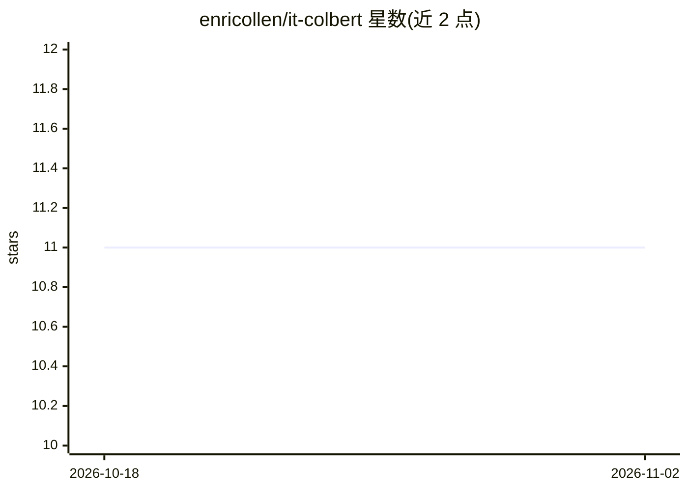

# enricollen/it-colbert

⭐ 11 · Python · Apache-2.0 · 推送 2026-09-22 · [GitHub](https://github.com/enricollen/it-colbert) · 个人维护

**意大利语单语 ColBERT 后期交互检索模型及训练评测代码**

面向意大利语搜索与 RAG 的单语 late-interaction（ColBERT）检索模型，用 PyLate 训练，权重托管于 Hugging Face；本仓库提供训练与评测代码及完整开发记录。机制：每个 token 保留一个小向量，通过 MaxSim 逐 token 匹配打分；约 135M 参数，两阶段训练（监督对比 + 交叉编码器蒸馏），并给出长文档查询时分块方案。限制：需要 Linux + 24GB NVIDIA GPU 训练复现，长文档场景依赖分块处理。

## 筛选速览

| 维度 | 判定 | 备注 |
|---|---|---|
| AI 角色 | `ai-native` | 本体是模型或模型工具 |
| 许可风险 | `permissive` | Apache-2.0 |
| 部署形态 | `library` | 以包/库形式分发 |
| 模型依赖 | — | README 未给出锁定关系 |
| 硬件要求 | — | 无带数字的原话,不猜 |
| 安装摩擦 | `low` | 无编译、无系统依赖或容器化 |
| 成熟度 | — | 结构信号不足 |

## 能力要点

- 约 135M 参数的意大利语专精 late-interaction 检索模型（Apache-2.0）
- 两阶段训练：监督对比 + 单一交叉编码器教师蒸馏
- 查询时 2000 字符重叠分块使 MLDR-it nDCG@10 从 0.4008 升至 0.4610，无需重训
- README 附带四基准（MLDR-it/mMARCO-it/MIRACL-ita/SQuAD-ita）成对 bootstrap 显著性检验结果

## 适用场景

- 为意大利语 RAG 或搜索系统提供检索/重排序模型
- 对比选型意大利语 late-interaction 与稠密检索模型
- 复现单消费级 GPU 上的 ColBERT 训练与评测流程

## 场景标签

`语义搜索` `微调` · 领域:知识与检索

## 证据(README 行号)

> L5: Monolingual **Italian late-interaction (ColBERT)** retriever for search and RAG,
> L16: vector. ColBERT-style **late interaction** models keep one small vector per
> L18: its best document token (MaxSim) rather than comparing two averaged blobs.

## 星数曲线

2026-10-18 11 → 2026-11-02 11（+0）

---
*卡片 v1 · prompt 1.4 · 生成 2026-11-02 · 置信度 mid · 依据 README sha `507e177f7178` · [字段定义](../../DATASET.md)*
