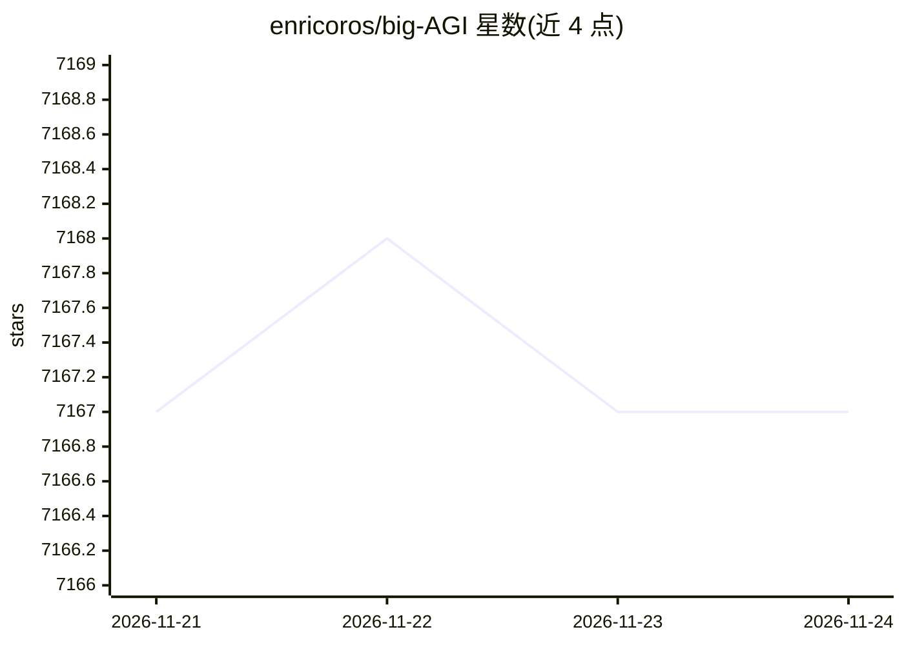

# enricoros/big-AGI

⭐ 7,167 · TypeScript · MIT · 推送 2026-11-20 · [GitHub](https://github.com/enricoros/big-AGI) · [官网](https://big-agi.com) · 个人维护

**面向专家的多模型 AI 工作区，自托管聊天与模型对比**

Big-AGI Open 是多模型 AI 工作区的开源基础：在对话中切换 800+ 模型、并排运行 Beam 多模型对比、检查请求与响应、支持 personas、图像生成与带引用的网页搜索。以自建 API 密钥（BYO keys）方式使用，提供 Docker 自托管与 Vercel 部署两种途径，另有 big-agi.com 免费与 Pro 订阅托管版本（$10.99/月）为开发提供资金。配置需用户自己的 API keys，模型用量不计费。

## 筛选速览

| 维度 | 判定 | 备注 |
|---|---|---|
| AI 角色 | `ai-native` | 本体是模型或模型工具 |
| 许可风险 | `permissive` | MIT |
| 部署形态 | `self-host` | docker 或自建部署 |
| 模型依赖 | local-ok | 支持本地模型 |
| 硬件要求 | — | 无带数字的原话,不猜 |
| 安装摩擦 | `low` | 无编译、无系统依赖或容器化 |
| 成熟度 | — | 结构信号不足 |

## 能力要点

- Beam & Merge 多模型并排对比与合并输出
- 本地优先（local-first）Web 应用，数据存储在本地
- 支持 20+ 供应商、100s 模型，含任意 OpenAI 兼容端点自动检测
- 提供 Docker / Vercel 自托管部署途径

## 适用场景

- 用自有 API 密钥自托管一个多模型聊天工作区
- 用 Beam 并排运行多个模型对比回答
- 接入本地模型服务（LocalAI/Ollama/LM Studio）进行本地推理聊天

## 场景标签

`聊天机器人` `图像生成` · 领域:对话与助手

## 证据(README 行号)

> L21: Big-AGI is the multi-model AI workspace for experts: Engineers architecting systems. Founders making decisions. Res
> L255: |Opensource Servers|LocalAI · Ollama|
> L258: |LLM services|Alibaba · DeepSeek · Groq · Mistral · Moonshot · NVIDIA NIM · OpenRouter · Perplexity · Together AI 

## 星数曲线

2026-11-21 7,167 → 2026-11-24 7,167（+0）

---
*卡片 v1 · prompt 1.4 · 生成 2026-11-21 · 置信度 high · 依据 README sha `0c8060e57922` · [字段定义](../../DATASET.md)*
