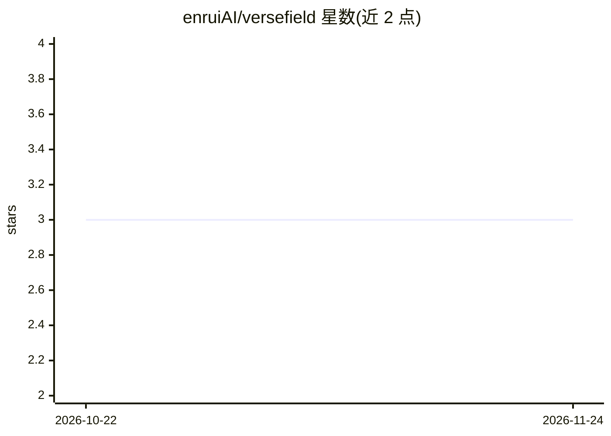

# enruiAI/versefield

⭐ 3 · JavaScript · Apache-2.0 · 推送 2026-10-20 · [GitHub](https://github.com/enruiAI/versefield) · 组织维护 · 中文 README

**给用户的歌词视频生成工具：一句歌词配一个 SVG 场景**

以 DSH Skill 与命令行流水线两种形式提供：输入歌名与歌词起止句，依次执行歌词检索（QQ 音乐主源/网易云备源）、音源搜索或使用本地音频、基于起音检测的对齐校验与截取、逐句画面分配（15 个可复用模板仅在贴合时借用，其余句子单独绘制）、生成每句一个 SVG 动画场景的单文件离线 HTML；附自动 QA 工具链（场景校验、单文件检查、真音频播放比对、音轨引擎测试）与基于无头 Chrome 加 ffmpeg 的逐帧 MP4 导出。仓库不含任何音源，发布作品需自行确认版权。

## 筛选速览

| 维度 | 判定 | 备注 |
|---|---|---|
| AI 角色 | `ai-native` | 本体是模型或模型工具 |
| 许可风险 | `permissive` | Apache-2.0 |
| 部署形态 | `library` | 以包/库形式分发 |
| 模型依赖 | — | README 未给出锁定关系 |
| 硬件要求 | — | 无带数字的原话,不猜 |
| 安装摩擦 | `medium` | 含编译或系统依赖之一 |
| 成熟度 | — | 结构信号不足 |

## 能力要点

- 歌词检索、音源获取、起音对齐截取到单文件 HTML 的一键流水线
- 15 个霓虹场景模板按贴合度逐句借用，整片调色板按歌名自动色相偏移
- 从真实音频离线分析 50fps 起音包络，画面与鼓点逐帧对齐
- 自带 QA 门禁与逐帧渲染 MP4 导出（默认 4 进程并行）

## 适用场景

- 为一段歌词快速生成可离线播放的歌词视频网页
- 把本地 BGM 按起唱点截取并配上逐句动画场景
- 生成后导出 MP4 用于发布或分享

## 场景标签

`视频生成` · 领域:内容生成

## 证据(README 行号)

> L15: VerseField（词场）是一个 **DSH Skill + 命令行工具**：给一首歌的名字和一段歌词（从哪句到哪句），
> L22: - **生成单文件网页**：每句歌词一个 SVG 动画场景，离线双击就能播放
> L35: - **真实音轨 + 卡点**：从真实音频离线分析 50fps 起音包络，场景里的鼓点、光环、心跳与音乐逐帧对齐。

## 星数曲线

2026-10-22 3 → 2026-11-24 3（+0）

---
*卡片 v1 · prompt 1.4 · 生成 2026-11-22 · 置信度 high · 依据 README sha `9554a981d1ad` · [字段定义](../../DATASET.md)*
