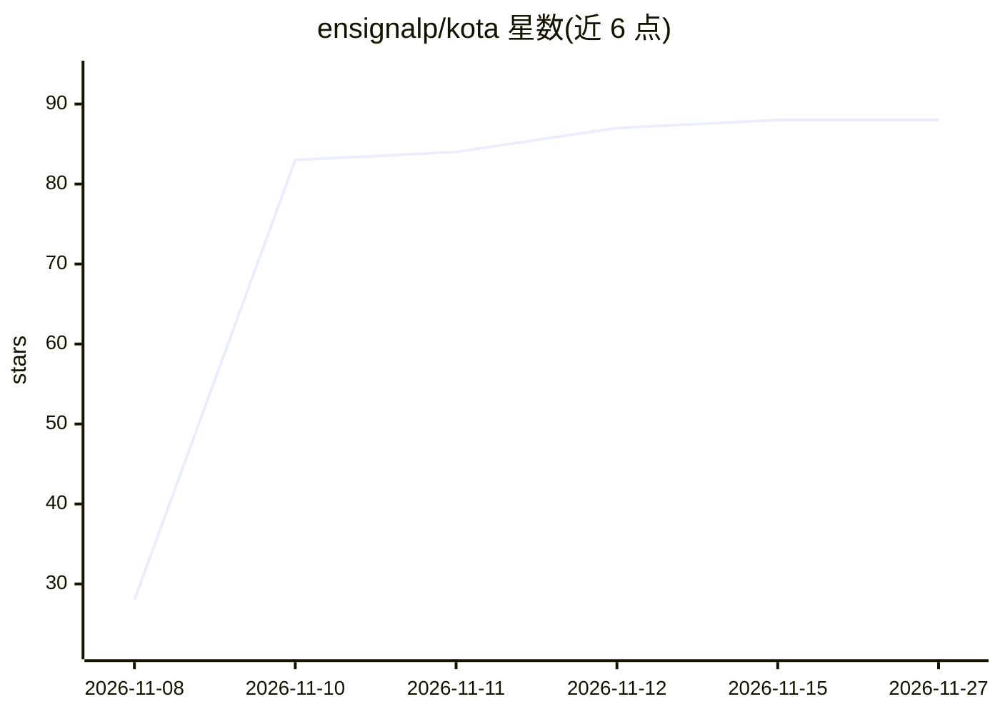

# ensignalp/kota

⭐ 88 · Rust · MIT · 推送 2026-11-08 · [GitHub](https://github.com/ensignalp/kota) · 个人维护 · 中文 README

**GNOME 顶栏显示各 AI 服务用量限额的监控扩展**

Rust 编写的 GNOME Shell 扩展加后台守护进程：读取 Claude、Codex、Gemini、GitHub Copilot、Z.ai、OpenRouter 等十余家 AI 服务的用量限额与 API 余额，在顶栏以百分比/环形图显示，提供重置倒计时、耗尽预测、24 小时 token 图表、运行中 agent 查看、多账户切换与阈值通知。认证凭据读取本地 CLI 登录文件或存入 GNOME 钥匙环，token 不写入日志。另有 Windows 版（Tauri 托盘应用）。所用 endpoint 未被官方文档化，可能随时变动。

## 筛选速览

| 维度 | 判定 | 备注 |
|---|---|---|
| AI 角色 | `ai-ecosystem` | LLM/agent 周边工具 |
| 许可风险 | `permissive` | MIT |
| 部署形态 | `desktop` | 安装包/桌面程序 |
| 模型依赖 | — | README 未给出锁定关系 |
| 硬件要求 | — | 无带数字的原话,不猜 |
| 安装摩擦 | `medium` | 含编译或系统依赖之一 |
| 成熟度 | — | 结构信号不足 |

## 能力要点

- 支持 11 家 AI 服务，顶栏/快速设置/日期面板三处展示
- 读取 Claude Code/Codex 本地登录文件实现零配置登录，token 存 GNOME 钥匙环
- 耗尽预警、24h/7d/30d 用量图表、运行中 agent（项目/内存/端口）查看与停止
- 静态二进制（x86_64/aarch64，无 glibc/OpenSSL 依赖），另提供 Windows 版与 CLI/Waybar 模块

## 适用场景

- 在桌面顶栏随时查看 Claude/Codex 套餐剩余额度
- 多账户（个人+工作）间快速切换并保留各自 token
- 接近限额时收到通知，避免高峰期额度提前耗尽
- Waybar/CLI 场景下以 JSON 获取用量数据

## 场景标签

 · 领域:桌面工具/AI 用量监控

## 证据(README 行号)

> L3: AI hizmetlerinin kullanım limitlerini GNOME üst panelinde gösterir: orijinal
> L19: ## Desteklenen sağlayıcılar
> L72: ## Mimari

## 星数曲线

2026-11-08 28 → 2026-11-27 88（+60）

---
*卡片 v1 · prompt 1.4 · 生成 2026-11-17 · 置信度 high · 依据 README sha `e166ded981bb` · [字段定义](../../DATASET.md)*
