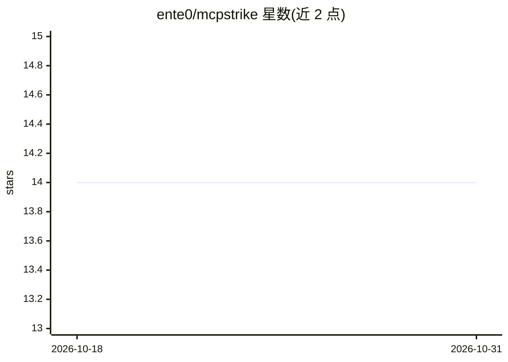

# ente0/mcpstrike

⭐ 14 · Python · GPL-3.0 · 推送 2026-08-29 · [GitHub](https://github.com/ente0/mcpstrike) · 个人维护

**MCP 服务器+客户端：让 Ollama LLM 自主驱动渗透测试工具**

由 Python 编写的渗透测试框架，含三个组件：基于 FastMCP 的 MCP 服务器（暴露 14-15 个工具用于会话/命令管理，默认端口 8889）、驱动 Ollama LLM 调用 MCP 工具的交互式 TUI 客户端，以及可选的本地轻量后端（8890）作为外部 hexstrike_server（8888）的替代。LLM 通过 MCP 协议调用 nmap、sqlmap、dalfox 等安全工具，支持自主/引导模式、5 种测试类型提示模板、超范围目标配置与 UA 注入。客户端-服务器间使用自动生成的 bearer token 与本地固定 TLS 身份，明文 HTTP 被拒绝。以 git clone + venv + pip install -e 源码方式安装。

## 筛选速览

| 维度 | 判定 | 备注 |
|---|---|---|
| AI 角色 | `ai-ecosystem` | LLM/agent 周边工具 |
| 许可风险 | `viral` | GPL-3.0 |
| 部署形态 | `library` | 以包/库形式分发 |
| 模型依赖 | local-ok | 支持本地模型 |
| 硬件要求 | — | 无带数字的原话,不猜 |
| 安装摩擦 | `low` | 无编译、无系统依赖或容器化 |
| 成熟度 | — | 结构信号不足 |

## 能力要点

- MCP 服务器暴露 14 个工具：配置、会话发现、命令执行、会话文件管理
- TUI 客户端支持自主 agent 模式、运行时切换 Ollama 模型、原生工具调用/JSON 回退
- 5 种测试类型（full/web_app/network/black_box/gray_box）控制 LLM 的阶段与工具优先级
- 客户端-服务器间 bearer token + 固定 TLS 身份认证，明文 HTTP 被拒绝

## 适用场景

- 安全测试人员用自然语言驱动 LLM 执行授权渗透测试
- 按测试类型（Web/网络/黑盒/灰盒）生成并加载渗透测试提示模板
- 在无 hexstrike_server 的环境中用可选本地后端执行安全工具命令

## 场景标签

`网络安全` · 领域:学习与行业

## 证据(README 行号)

> L12: mcpstrike connects an LLM (via Ollama) to security tools through the Model Context Protocol (MCP), enabling autonom
> L28: |`mcpstrike-server`|MCP server exposing 15 tools for session/command management|8889|
> L29: |`mcpstrike-client`|Interactive TUI that drives an Ollama LLM to call MCP tools|—|

## 星数曲线

2026-10-18 14 → 2026-10-31 14（+0）

---
*卡片 v1 · prompt 1.4 · 生成 2026-10-31 · 置信度 high · 依据 README sha `c34cd8946043` · [字段定义](../../DATASET.md)*
