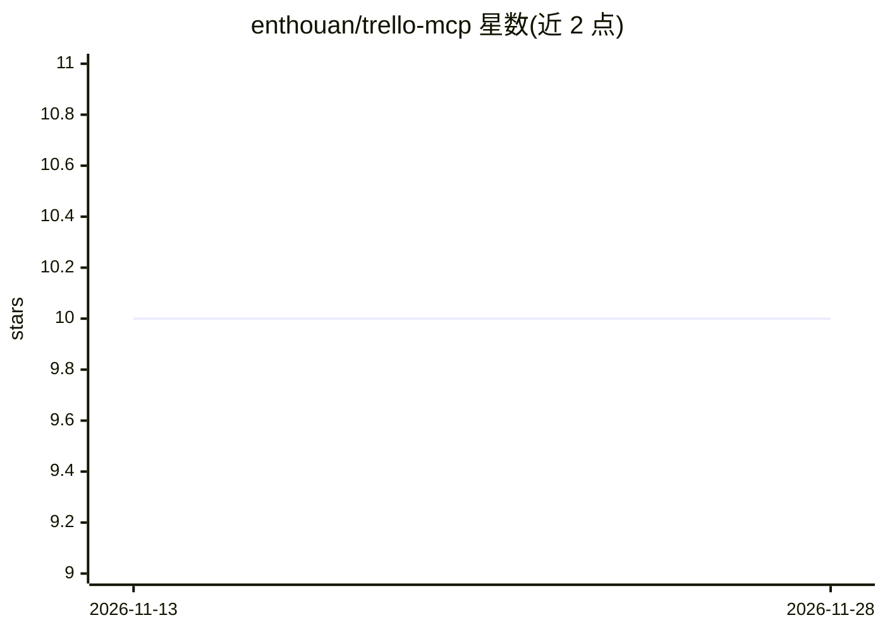

# enthouan/trello-mcp

⭐ 10 · TypeScript · MIT · 推送 2026-11-27 · [GitHub](https://github.com/enthouan/trello-mcp) · [官网](https://trello-mcp.com) · 个人维护

**自托管的 Trello MCP 服务器：让 MCP 客户端操作 Trello**

一个可自托管的 Model Context Protocol 服务器，通过 Trello 公开 API 与用户提供的 API 凭据，向 MCP 兼容客户端暴露 77 个工具，覆盖看板/列表/卡片/标签/附件/清单/成员/活动等操作，支持 stdio（本地子进程）与 Streamable HTTP（容器部署）两种传输，提供健康检查端点、可选 Bearer 鉴权、日志凭据脱敏与限流配置。通过 GHCR 镜像用 Docker Compose 运行，或以 Node.js 24.x + pnpm 从源码构建。项目声明为社区维护，非 Trello/Atlassian 官方产品。

## 筛选速览

| 维度 | 判定 | 备注 |
|---|---|---|
| AI 角色 | `ai-ecosystem` | LLM/agent 周边工具 |
| 许可风险 | `permissive` | MIT |
| 部署形态 | `self-host` | docker 或自建部署 |
| 模型依赖 | — | README 未给出锁定关系 |
| 硬件要求 | — | 无带数字的原话,不猜 |
| 安装摩擦 | `low` | 无编译、无系统依赖或容器化 |
| 成熟度 | — | 结构信号不足 |

## 能力要点

- 77 个 MCP 工具覆盖 Trello 卡片、列表、标签、附件、清单、成员与活动操作
- 支持 stdio 与 Streamable HTTP 两种传输，带健康/就绪端点与可选 Bearer 鉴权
- 提供 GHCR 预构建镜像与 Docker Compose 部署，支持版本化 tag 与 digest 固定
- 基于 Zod 校验配置与输入，日志中脱敏 Trello 凭据

## 适用场景

- 让 Claude Desktop 等 MCP 客户端以自然语言管理 Trello 看板与卡片
- 在自托管服务器上以自有 API 凭据接入 Trello 工作流
- 容器化部署并向局域网或反向代理暴露 MCP 端点

## 场景标签

 · 领域:LLM 基础设施/MCP 工具服务

## 证据(README 行号)

> L3: A self-hostable Model Context Protocol server that lets MCP-compatible clients work with Trello cards, lists, labels
> L79: - Use stdio for local MCP clients that launch the server as a child process.

## 星数曲线

2026-11-13 10 → 2026-11-28 10（+0）

---
*卡片 v1 · prompt 1.4 · 生成 2026-11-19 · 置信度 high · 依据 README sha `cee96094fded` · [字段定义](../../DATASET.md)*
