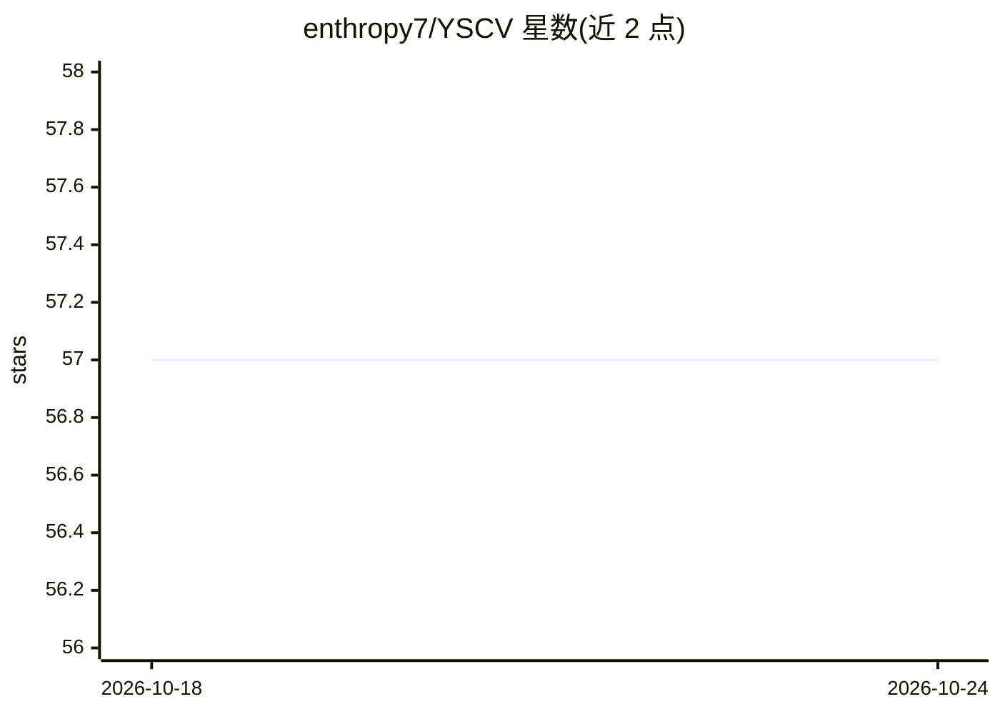

# enthropy7/YSCV

⭐ 57 · Rust · Apache-2.0 · 推送 2026-10-24 · [GitHub](https://github.com/enthropy7/YSCV) · 个人维护

**纯 Rust 的边缘端计算机视觉与深度学习框架**

面向 CPU 边缘设备（树莓派、Rockchip/Allwinner SBC、ARM Cortex-A 与低功耗 x86）的纯 Rust 计算机视觉与深度学习框架，目标定位为 ONNX Runtime CPU 执行提供者的替代：加载 ONNX 模型后由单一 crate 自动检测主机选择最优路径。提供 182 个图像处理算子、39 种层类型的神经网络训练、122 算子的 ONNX 推理（INT4/INT8 量化）、LLM 生成（KV-cache/RoPE/GQA）、YOLO 检测跟踪识别流水线、视频解码与 Vulkan/Metal/DX12 GPU 计算，零必需系统依赖、零 Python/C++ 依赖。项目自我标注为 work in progress（0.2.0 里程碑去除此标签）。

## 筛选速览

| 维度 | 判定 | 备注 |
|---|---|---|
| AI 角色 | `ai-native` | 本体是模型或模型工具 |
| 许可风险 | `permissive` | Apache-2.0 |
| 部署形态 | `library` | 以包/库形式分发 |
| 模型依赖 | — | README 未给出锁定关系 |
| 硬件要求 | — | 无带数字的原话,不猜 |
| 安装摩擦 | `medium` | 含编译或系统依赖之一 |
| 成熟度 | `idea` | |

## 能力要点

- ONNX 推理 122 算子 + INT4/INT8 量化，目标为 ONNX Runtime CPU 路径的 drop-in replacement
- 603 个 target_feature 门控 SIMD 函数按运行时 CPU 检测分派（NEON/AVX/SSE）
- 19 个 crate 组成：训练、自动求导、检测/跟踪/识别、视频解码、TOML 驱动多加速器流水线
- 零必需系统依赖、零 Python/C++ 依赖，编译为单一静态链接二进制

## 适用场景

- 在树莓派或 Rockchip SBC 上部署 ONNX 模型的 CPU 推理
- 用纯 Rust 完成 CV + 训练 + 检测跟踪识别的端到端开发
- 在 Apple Silicon 上用 MPSGraph 后端运行 GPU 推理

## 场景标签

`图像视频处理` `目标检测` `推理引擎` · 领域:感知与多模态

## 证据(README 行号)

> L15: A complete computer vision and deep learning framework in pure Rust. One `cargo add yscv` gives you image processin
> L17: > Project focus. YSCV is built for CPU inference on edge devices — Raspberry Pi, Rockchip / Allwinner SBCs, drone b

## 星数曲线

2026-10-18 57 → 2026-10-24 57（+0）

---
*卡片 v1 · prompt 1.4 · 生成 2026-10-24 · 置信度 high · 依据 README sha `384c1a1b8129` · [字段定义](../../DATASET.md)*
