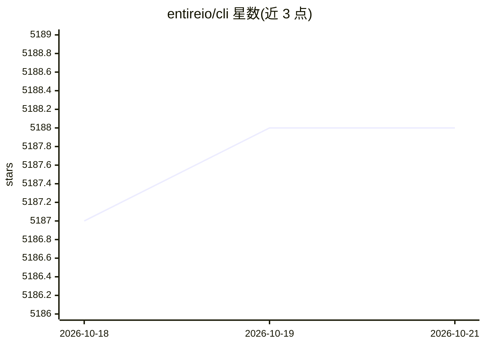

# entireio/cli

⭐ 5,188 · Go · MIT · 推送 2026-10-19 · [GitHub](https://github.com/entireio/cli) · [官网](https://entire.io) · 组织维护

**随 Git 工作流捕获 AI agent 会话并按提交索引的工具**

Entire CLI 通过安装 git hooks 在开发者工作时后台捕获 AI agent 会话：记录完整 prompt/response 转录、改动文件、token 用量与工具调用；用户或 agent 提交时生成 checkpoint，以独立 git ref 存于仓库对象库而不进入分支历史，并通过 commit 中的 Entire-Checkpoint trailer 关联。支持从 checkpoint 恢复会话、多 worktree 与并发会话。兼容 Claude Code、Codex、Cursor 等 agent。提供 Homebrew、Scoop、安装脚本及 go install 途径；要求 Git 与已安装认证的受支持 agent。

## 筛选速览

| 维度 | 判定 | 备注 |
|---|---|---|
| AI 角色 | `ai-ecosystem` | LLM/agent 周边工具 |
| 许可风险 | `permissive` | MIT |
| 部署形态 | `desktop` | 安装包/桌面程序 |
| 模型依赖 | — | README 未给出锁定关系 |
| 硬件要求 | — | 无带数字的原话,不猜 |
| 安装摩擦 | `low` | 无编译、无系统依赖或容器化 |
| 成熟度 | — | 结构信号不足 |

## 能力要点

- 以独立 git ref 存储 checkpoint，不污染分支历史
- 捕获转录、文件改动、token 用量等会话数据并按提交索引
- entire session resume 可从 checkpoint 恢复会话
- 支持 Claude Code、Codex、Cursor、Antigravity、Pi 等多种 agent

## 适用场景

- 回溯某次提交对应的 AI 提示与对话过程
- 中断后从 checkpoint 恢复 agent 会话继续工作
- 满足审计合规需求，保留 AI 交互记录
- 帮助新成员理解 prompt→改动→提交的路径

## 场景标签

`LLM 可观测性` · 领域:评测与运维

## 证据(README 行号)

> L3: Entire hooks into your Git workflow to capture AI agent sessions as you work. Sessions are indexed alongside commits
> L18: - **Zero context switching** — Git-native, two-step setup, works with Claude Code, Codex, Cursor, Antigravity, Pi, 
> L138: The hooks capture session data as you work. Checkpoints are created when you or the agent make a git commit. Your 

## 星数曲线

2026-10-18 5,187 → 2026-10-21 5,188（+1）

---
*卡片 v1 · prompt 1.4 · 生成 2026-10-20 · 置信度 high · 依据 README sha `663f9a0a59ac` · [字段定义](../../DATASET.md)*
