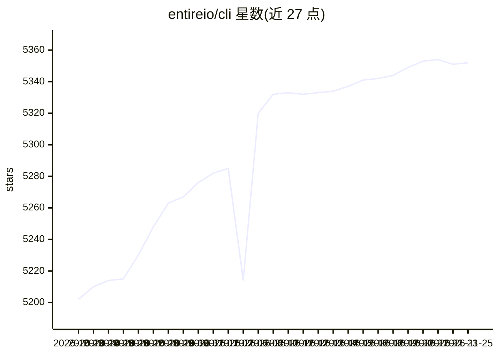

# entireio/cli

⭐ 5,352 · Go · MIT · 推送 2026-11-24 · [GitHub](https://github.com/entireio/cli) · [官网](https://entire.io) · 组织维护

**开发者终端工具：捕获 agent 会话并与提交关联成可检索记录**

Entire CLI 是 Entire（面向 agent 与人协作的 Git 托管平台）的终端入口：通过 git hooks 将 Claude Code、Codex、Cursor 等 agent 的会话捕获为 checkpoint，以 git refs 形式随提交推送；提供分布式 Git 托管与 GitHub 镜像、Trail（推送时由 review/风险/安全等 agent 打分的变更面板）、混合检索 checkpoint 与提交的项目记忆搜索、插件机制与 `gh api` 风格的原始 API 访问。MIT 许可，macOS/Linux/Windows 可装，需要 Git。

## 筛选速览

| 维度 | 判定 | 备注 |
|---|---|---|
| AI 角色 | `ai-ecosystem` | LLM/agent 周边工具 |
| 许可风险 | `permissive` | MIT |
| 部署形态 | `library` | 以包/库形式分发 |
| 模型依赖 | — | README 未给出锁定关系 |
| 硬件要求 | — | 无带数字的原话,不猜 |
| 安装摩擦 | `low` | 无编译、无系统依赖或容器化 |
| 成熟度 | — | 结构信号不足 |

## 能力要点

- 捕获 agent 会话为 checkpoint，经 Entire-Checkpoint trailer 与提交关联，存储为独立 git refs
- Trail：每次推送由可配置 review agent（风险/置信度/漂移/安全）打分并给出 findings
- 对 checkpoints、commits、sessions 的语义+关键词混合搜索，支持 --json 输出适配 agent
- GitHub 镜像保持 GitHub 为事实源，推送转发回 GitHub 且沿用其权限与分支保护

## 适用场景

- 在代码仓库中保留 agent 编码过程的提示词、转录与文件记录，便于事后检索
- 用多个 review agent 在每次推送时自动评估变更
- 将 GitHub 仓库镜像到指定区域集群以就近服务 agent 流量
- 在新会话中恢复某分支的历史 agent 上下文继续工作

## 场景标签

`编码 Agent` `代码审查` · 领域:编码与开发

## 证据(README 行号)

> L5: Entire is a Git forge built for agent–human collaboration. This CLI is how you and your agents use Entire from the t
> L103: `entire enable` connects your agents and installs Entire's git hooks, keeping any hooks you already have. Use your

## 星数曲线

2026-10-23 5,202 → 2026-11-25 5,352（+150）

---
*卡片 v1 · prompt 1.4 · 生成 2026-11-22 · 置信度 high · 依据 README sha `0c2dc3fc3c30` · [字段定义](../../DATASET.md)*
