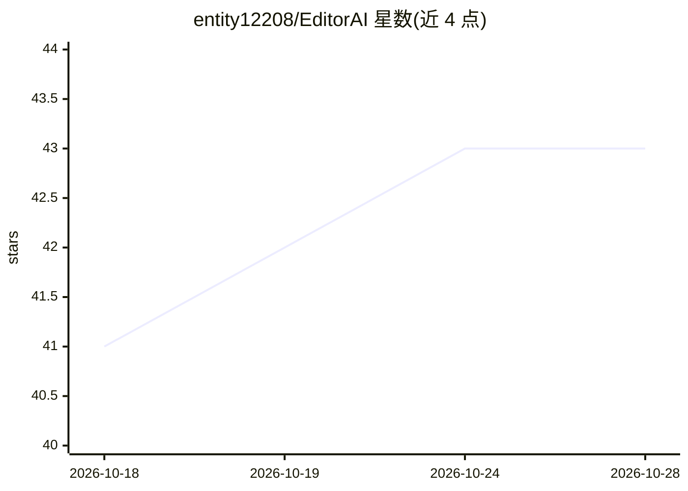

# entity12208/EditorAI

⭐ 43 · C++ · MIT · 推送 2026-10-04 · [GitHub](https://github.com/entity12208/EditorAI) · [官网](https://editorai.pages.dev) · 个人维护

**让 AI 按自然语言描述在 Geometry Dash 编辑器中自动搭建关卡**

基于 Geode 的 Geometry Dash 模组：用户用自然语言描述关卡，EditorAI 调用所选 AI 生成内容并自动放置到编辑器的独立预览层，用户可接受、编辑或拒绝结果。支持多种提供方：免费社区运行的 Platinum、本地 Ollama，以及 OpenRouter、Claude、OpenAI、DeepSeek 等托管服务，兼容 LM Studio、llama.cpp 等任意 OpenAI 兼容端点。支持歌曲分析同步、跨生成的记忆与任务清单机制，可基于 EditorAI 数据集微调模型。不在 Geode 索引分发，需手动安装 .geode 文件。

## 筛选速览

| 维度 | 判定 | 备注 |
|---|---|---|
| AI 角色 | `ai-enhanced` | 去掉 AI 部分产品仍成立 |
| 许可风险 | `permissive` | MIT |
| 部署形态 | `None` |  |
| 模型依赖 | local-ok | 支持本地模型 |
| 硬件要求 | — | 无带数字的原话,不猜 |
| 安装摩擦 | `low` | 无编译、无系统依赖或容器化 |
| 成熟度 | — | 结构信号不足 |

## 能力要点

- 自然语言生成关卡并实时放置到编辑器独立预览层，可接受/编辑/拒绝
- 支持 Platinum 免费社区推理、本地 Ollama 与多家托管 API
- 分析歌曲 BPM 与波形以同步玩法
- 跨生成保持 scratch memory 并以任务清单驱动生成，可评分反馈偏好

## 适用场景

- 用自然语言描述快速生成 Geometry Dash 关卡草稿
- 本地或免费社区算力下离线生成关卡
- 逐步对话迭代调整关卡设计

## 场景标签

 · 领域:游戏/关卡生成

## 证据(README 行号)

> L3: Describe a Geometry Dash level in plain words and watch it get built for you. EditorAI talks to the AI of your choic
> L17: Press **E** anywhere in the game (desktop), or tap the floating **AI** bubble (mobile). Everything lives in that pa

## 星数曲线

2026-10-18 41 → 2026-10-28 43（+2）

---
*卡片 v1 · prompt 1.4 · 生成 2026-10-25 · 置信度 high · 依据 README sha `c5524722d6ad` · [字段定义](../../DATASET.md)*
