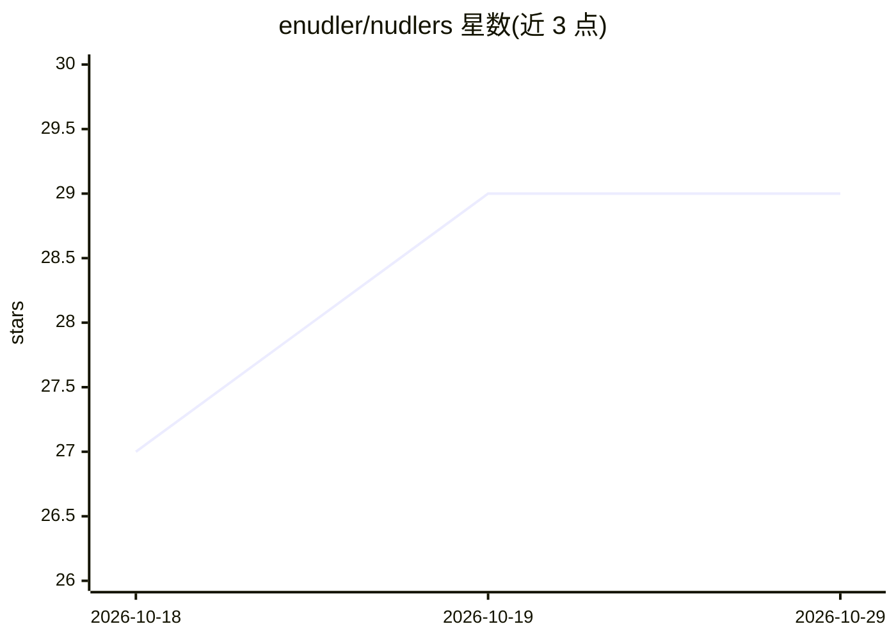

# enudler/nudlers

⭐ 29 · TypeScript · NOASSERTION · 推送 2026-10-09 · [GitHub](https://github.com/enudler/nudlers) · [官网](https://nudlers.com) · 个人维护

**自托管的以色列银行个人财务聚合看板，含 AI 分类与问答**

面向以色列银行用户的自托管个人财务工具：自动抓取 13 家银行与 4 家信用卡机构的交易，聚合到统一看板，提供三阶段自动分类（规则/历史学习/按需补充）、异常洞察（订阅涨价、新增周期扣费、类别消费突增）、余额预测、预算管理与 WhatsApp 每日摘要。AI 部分为可选：任何 OpenAI 兼容 API 做自然语言财务问答，并通过 MCP 接入 Claude Desktop/Cursor 等助手。凭据采用内存锁定保险库、AES-256-GCM 加密，本地处理零遥测。Docker 一键部署，支持 NAS 与树莓派低内存模式。

## 筛选速览

| 维度 | 判定 | 备注 |
|---|---|---|
| AI 角色 | `ai-enhanced` | 去掉 AI 部分产品仍成立 |
| 许可风险 | `none` | NOASSERTION |
| 部署形态 | `self-host` | docker 或自建部署 |
| 模型依赖 | local-ok | 支持本地模型 |
| 硬件要求 | — | 无带数字的原话,不猜 |
| 安装摩擦 | `low` | 无编译、无系统依赖或容器化 |
| 成熟度 | — | 结构信号不足 |

## 能力要点

- 聚合 13 家以色列银行与 4 家信用卡机构交易，每日自动同步
- 三阶段自动分类（规则匹配/历史学习/按需补充），初始设置后约 95% 交易自动分类
- 任意 OpenAI 兼容 API（OpenRouter/OpenAI/Groq/Ollama 等）自然语言财务问答，MCP 接入 AI 助手
- 内存锁定保险库 + AES-256-GCM 凭据加密，本地处理零遥测

## 适用场景

- 把多家以色列银行和信用卡的账户集中到一个看板管理
- 自动发现订阅涨价和被遗忘的周期扣费
- 用 WhatsApp 接收每日财务摘要与异常提醒
- 在 NAS 或树莓派上自部署，数据不出本地

## 场景标签

`数据分析` `网页抓取` · 领域:效率与自动化

## 证据(README 行号)

> L5:  Automatically aggregate, categorize, and analyze your finances from all Israeli banks and credit cards in one beaut
> L73: Ask questions about your finances in plain language. Bring your own AI provider — any OpenAI-compatible API works (
> L83: Connect Nudlers directly to **Claude Desktop**, **Cursor**, or **Claude Code** using the Model Context Protocol.

## 星数曲线

2026-10-18 27 → 2026-10-29 29（+2）

---
*卡片 v1 · prompt 1.4 · 生成 2026-10-26 · 置信度 mid · 依据 README sha `4348180928b5` · [字段定义](../../DATASET.md)*
