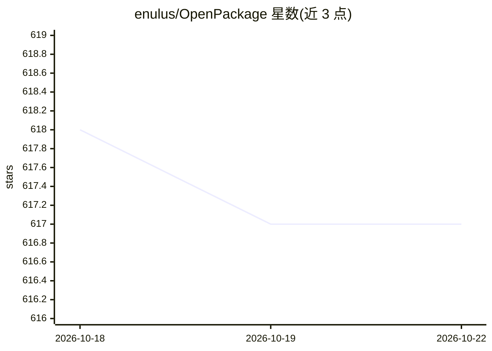

# enulus/OpenPackage

⭐ 617 · TypeScript · Apache-2.0 · 推送 2026-05-29 · [GitHub](https://github.com/enulus/OpenPackage) · [官网](https://openpackage.dev) · 个人维护

**面向 AI 编程工具的配置包管理器：统一安装规则/命令/代理/技能**

OpenPackage（命令 opkg）是一个 npm 分发的 CLI 包管理器，用于跨平台安装、卸载、打包 AI 编程工具的配置文件，覆盖 rules、commands、agents、skills 与 MCP。内置跨平台格式转换与安装目录解析，支持 40 个平台（Claude Code、Cursor、Codex CLI、GitHub Copilot 等），通过 platforms.jsonc 可自定义并按本地>全局>内置深度合并。提供 list/add/remove/new 等命令，可组合配置文件为包并声明依赖，用于在多平台、多代码库间同步与复用配置。

## 筛选速览

| 维度 | 判定 | 备注 |
|---|---|---|
| AI 角色 | `ai-ecosystem` | LLM/agent 周边工具 |
| 许可风险 | `permissive` | Apache-2.0 |
| 部署形态 | `library` | 以包/库形式分发 |
| 模型依赖 | — | README 未给出锁定关系 |
| 硬件要求 | — | 无带数字的原话,不猜 |
| 安装摩擦 | `low` | 无编译、无系统依赖或容器化 |
| 成熟度 | — | 结构信号不足 |

## 能力要点

- 单条命令安装/卸载 rules、commands、agents、skills、MCP 配置
- 内置跨平台格式转换与目录解析，支持 40 个 AI 编程平台
- platforms.jsonc 可按全局/工作区覆盖内置平台定义（深度合并）
- opkg new/add/remove 组合配置文件为可复用、可声明依赖的包

## 适用场景

- 在多个 AI 编程工具间同步规则与技能配置
- 把团队的 agent 配置打包并在多个代码库复用
- 按平台约定目录批量安装 Claude Plugins、Skills 等资源

## 场景标签

 · 领域:开发工具/AI 编程工具链

## 证据(README 行号)

> L23: OpenPackage enables simple, modular management of coding agent configs, providing unified installation, management,
> L29: OpenPackage provides a centralized and universal interface for installing, uninstalling, and packaging coding agent
> L45: At its core, OpenPackage is a lightweight CLI package manager that performs installs and uninstalls of config files

## 星数曲线

2026-10-18 618 → 2026-10-22 617（-1）

---
*卡片 v1 · prompt 1.4 · 生成 2026-10-21 · 置信度 high · 依据 README sha `13e035b84b1e` · [字段定义](../../DATASET.md)*
