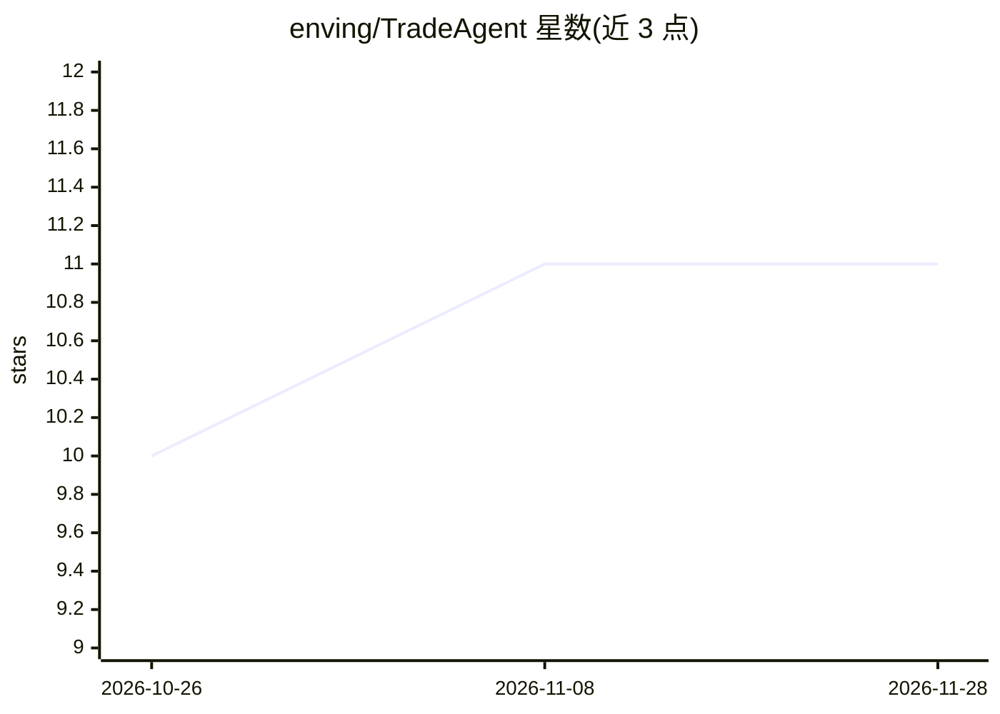

# enving/TradeAgent

⭐ 11 · Python · MIT · 推送 2026-11-15 · [GitHub](https://github.com/enving/TradeAgent) · 个人维护

**面向个人交易者的 AI 算法交易机器人：动量信号+新闻情感分析**

基于 Python 3.12 的算法交易系统，针对 Alpaca paper trading API 运行：动量策略（RSI/MACD/成交量信号）、月度再平衡防御组合、Kelly 法则仓位管理、板块集中度限制与熔断机制。LLM 部分（可选）通过 OpenRouter 调用 Claude 3.5 Sonnet 分析每只股票 90+ 篇新闻文章并跟踪情感趋势；另有基于滚动 30 日表现的网格搜索参数优化器。交易、信号与 LLM 分析日志存入 Supabase。支持 Docker/Podman 定时调度部署。

## 筛选速览

| 维度 | 判定 | 备注 |
|---|---|---|
| AI 角色 | `ai-enhanced` | 去掉 AI 部分产品仍成立 |
| 许可风险 | `permissive` | MIT |
| 部署形态 | `library` | 以包/库形式分发 |
| 模型依赖 | locked-api |  |
| 硬件要求 | — | 无带数字的原话,不猜 |
| 安装摩擦 | `low` | 无编译、无系统依赖或容器化 |
| 成熟度 | — | 结构信号不足 |

## 能力要点

- Claude 3.5 Sonnet 新闻情感分析（90+ 篇/股票）与情感趋势跟踪
- 自适应参数优化器：基于滚动 30 日表现做网格搜索
- 风险管理：Kelly 仓位、板块上限、-3% 日内熔断、bracket orders
- Docker/Podman 定时调度，工作日 9:35 AM ET 自动运行

## 适用场景

- 在 Alpaca paper trading 环境下自动运行动量交易策略
- 结合新闻情感信号辅助交易决策
- 每日自动生成 Sharpe ratio 跟踪等绩效报告
- 用场景模拟器（Flash Crash、Market Gap）测试策略行为

## 场景标签

`金融量化` · 领域:学习与行业

## 证据(README 行号)

> L17: **TradeAgent** is a production-ready hybrid AI trading system that combines deterministic technical analysis with L
> L23: - **News Sentiment Analysis**: Claude 3.5 Sonnet analyzes 90+ articles per ticker
> L50: - **OpenRouter API Key** (Sign up) (optional, for LLM features)

## 星数曲线

2026-10-26 10 → 2026-11-28 11（+1）

---
*卡片 v1 · prompt 1.4 · 生成 2026-11-18 · 置信度 high · 依据 README sha `632eb7bb2269` · [字段定义](../../DATASET.md)*
