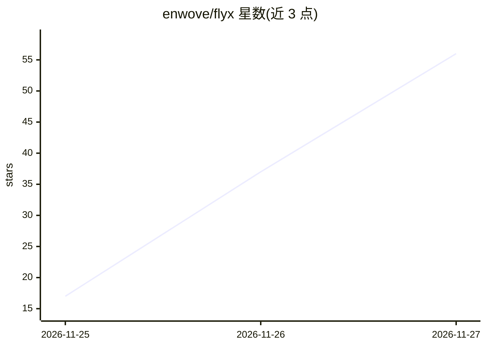

# enwove/flyx

⭐ 56 · C++ · Apache-2.0 · 推送 2026-11-26 · [GitHub](https://github.com/enwove/flyx) · [官网](https://enwove.ai/product/flyx) · 个人维护 · 中文 README

**单文件本地 LLM 推理引擎：跑 GGUF 并提供兼容 API**

FLYX 是一个零依赖的本地 LLM 推理引擎，以约 50 MB 的单文件二进制发布（Windows .exe 与 Linux tarball），运行 GGUF/NVFP4 格式模型并内置 Web 控制台（7 语言）。通过 OpenAI 和 Anthropic 兼容 API 向浏览器、脚本与编码 agent 提供服务；内置投机解码（MTP/DFlash2）、K/V 缓存超出显存时溢出到系统 RAM 的长上下文机制，并按 11 款 NVIDIA GPU 预置内核调优表自动分配显存/内存。仅支持稠密文本模型，不支持 MoE 与视觉模型；要求 NVIDIA 驱动 ≥ 580。

## 筛选速览

| 维度 | 判定 | 备注 |
|---|---|---|
| AI 角色 | `ai-ecosystem` | LLM/agent 周边工具 |
| 许可风险 | `permissive` | Apache-2.0 |
| 部署形态 | `desktop` | 安装包/桌面程序 |
| 模型依赖 | — | README 未给出锁定关系 |
| 硬件要求 | — | 无带数字的原话,不猜 |
| 安装摩擦 | `high` | 编译与系统依赖俱全 |
| 成熟度 | `idea` | |

## 能力要点

- 约 50 MB 零依赖单文件二进制，仅需 NVIDIA 驱动 ≥ 580
- 内置 Web 控制台：模型管理、对话、吞吐与显存监控
- 提供 OpenAI 与 Anthropic 兼容 API 及工具调用
- 内置 MTP/DFlash2 投机解码与每 GPU 内核调优表

## 适用场景

- 在消费级 NVIDIA GPU 上本地运行 GGUF 模型
- 为 Claude Code / Codex CLI 等编码 agent 提供本地 API 后端
- 通过浏览器控制台管理模型与监控推理状态
- 长上下文文档对话与检索测试（32K–256K）

## 场景标签

`推理引擎` · 领域:训练与推理

## 证据(README 行号)

> L22: **FLYX** is a zero-dependency local LLM engine in a ~50 MB binary — native long context, tuned per GPU, no setup re
> L33: - **One-click coding agent integration** — Speaks OpenAI (Chat Completions, Responses) and Anthropic Messages with 
> L111: |GPUs|RTX 30 / 40 / 50 series, L4, L40S, A100, H100 (`sm_80`–`sm_120`; `sm_100` in Linux release)|Single GPU per p

## 星数曲线

2026-11-25 17 → 2026-11-27 56（+39）

---
*卡片 v1 · prompt 1.4 · 生成 2026-11-24 · 置信度 high · 依据 README sha `def09d03abde` · [字段定义](../../DATASET.md)*
