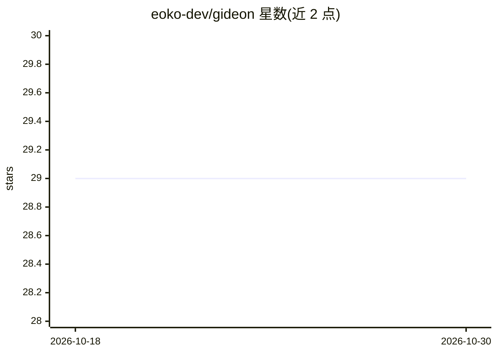

# eoko-dev/gideon

⭐ 29 · Python · MIT · 推送 2026-10-22 · [GitHub](https://github.com/eoko-dev/gideon) · [官网](https://eoko-dev.github.io/gideon/) · 组织维护

**面向 Discord 服务器的 AI 助手机器人，提供对话/绘图/记忆/提醒**

基于 Py-Cord 2.8 的 Python Discord 机器人，通过 OpenRouter 接入 OpenAI、Anthropic Claude、Google Gemini 等模型，支持流式对话、原生工具调用（提醒、活动 RSVP、投票、网络搜索）、图像与视频生成（多后端：AI Horde、Cloudflare Worker、DALL-E、ComfyUI、OpenRouter）。具备频道级与用户级持久记忆、频道隔离的 per-channel persona（Webhook 实现）、Web 管理面板（API key 加密存储、用量成本控制、备份恢复）。安装需 Discord bot token 与 OpenRouter API key，提供 Docker 与 Python 两种部署方式。

## 筛选速览

| 维度 | 判定 | 备注 |
|---|---|---|
| AI 角色 | `ai-native` | 本体是模型或模型工具 |
| 许可风险 | `permissive` | MIT |
| 部署形态 | `self-host` | docker 或自建部署 |
| 模型依赖 | locked-api |  |
| 硬件要求 | — | 无带数字的原话,不猜 |
| 安装摩擦 | `low` | 无编译、无系统依赖或容器化 |
| 成熟度 | — | 结构信号不足 |

## 能力要点

- 通过 OpenRouter 接入多家模型，支持在命令中切换
- 频道隔离的长期记忆：频道静默后自动总结并存为记忆条目
- 原生工具调用：提醒、活动 RSVP、网络搜索、图像/视频生成、频道内查询
- Web 管理面板：Fernet 加密的 API key 管理、用量与成本控制、备份恢复

## 适用场景

- 在 Discord 服务器里通过 @mention 使用 AI 对话与图像生成
- 让 bot 记住频道历史与个人偏好，延续讨论上下文
- 用自然语言设置提醒、活动、投票等社区管理操作
- 管理员通过 Web 面板管理模型、成本限额与人设

## 场景标签

`AI 助手` `聊天机器人` `图像生成` `视频生成` · 领域:对话与助手

## 证据(README 行号)

> L20: Gideon is an AI butler for your Discord server. Talk to it naturally — @mention it, reply to it, or use slash comma
> L26: * **Multiple AI Models** - Access OpenAI, Anthropic Claude, Google Gemini, and more through OpenRouter

## 星数曲线

2026-10-18 29 → 2026-10-30 29（+0）

---
*卡片 v1 · prompt 1.4 · 生成 2026-10-26 · 置信度 mid · 依据 README sha `87b00d952404` · [字段定义](../../DATASET.md)*
