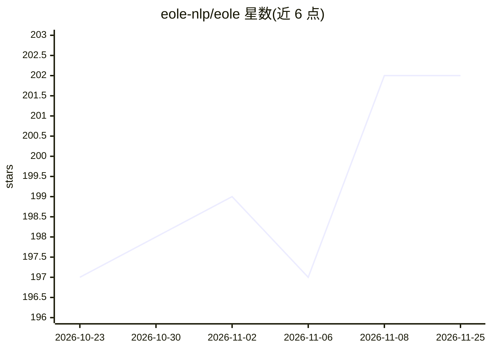

# eole-nlp/eole

⭐ 202 · Python · MIT · 推送 2026-11-23 · [GitHub](https://github.com/eole-nlp/eole) · [官网](https://eole-nlp.github.io/eole) · 组织维护

**基于 PyTorch 的开源语言建模工具包：训练/微调/评测/推理服务**

从 OpenNMT-py 衍生的语言建模工具包，覆盖训练、微调（含 LoRA、量化微调、REINFORCE）、评测（BLEU/chrF/COMET 等）与推理服务（FastAPI 服务器，OpenAI/Anthropic 风格 API）。支持 encoder/decoder/encoder-decoder 架构与 MTP 投机解码（DFlash2），可加载多种 Hugging Face 检查点。内置浏览器工作区提供聊天、翻译、OCR、RAG 与基准测试。要求 Python ≥3.11 与 CUDA PyTorch，CUDA 扩展需本地编译。

## 筛选速览

| 维度 | 判定 | 备注 |
|---|---|---|
| AI 角色 | `ai-ecosystem` | LLM/agent 周边工具 |
| 许可风险 | `permissive` | MIT |
| 部署形态 | `self-host` | docker 或自建部署 |
| 模型依赖 | — | README 未给出锁定关系 |
| 硬件要求 | — | 无带数字的原话,不猜 |
| 安装摩擦 | `low` | 无编译、无系统依赖或容器化 |
| 成熟度 | — | 结构信号不足 |

## 能力要点

- 训练、微调、评测、推理服务一体化工具链
- DFlash2 投机解码与 MTP 多 token 预测支持
- FastAPI 服务器提供 OpenAI/Anthropic 风格 API
- 内置浏览器工作区：聊天/翻译/OCR/RAG/监控

## 适用场景

- 从零训练或微调 Transformer 语言模型与翻译模型
- 本地部署 Qwen 等开源模型并提供 API 服务
- 用 COMET/MetricX 等神经指标评测翻译质量
- 浏览器内对话、翻译文档与提取 OCR Markdown

## 场景标签

`模型训练` `微调` `模型评测` · 领域:评测与运维

## 证据(README 行号)

> L5: Eole is an open language modeling toolkit built on PyTorch, originally spun off
> L6: from OpenNMT-py. Train, fine-tune, evaluate, and serve encoder, decoder, and
> L163: - **Serving:** FastAPI server with native inference, OpenAI-style Chat and Responses,

## 星数曲线

2026-10-23 197 → 2026-11-25 202（+5）

---
*卡片 v1 · prompt 1.4 · 生成 2026-11-25 · 置信度 mid · 依据 README sha `bc4b0cc43496` · [字段定义](../../DATASET.md)*
