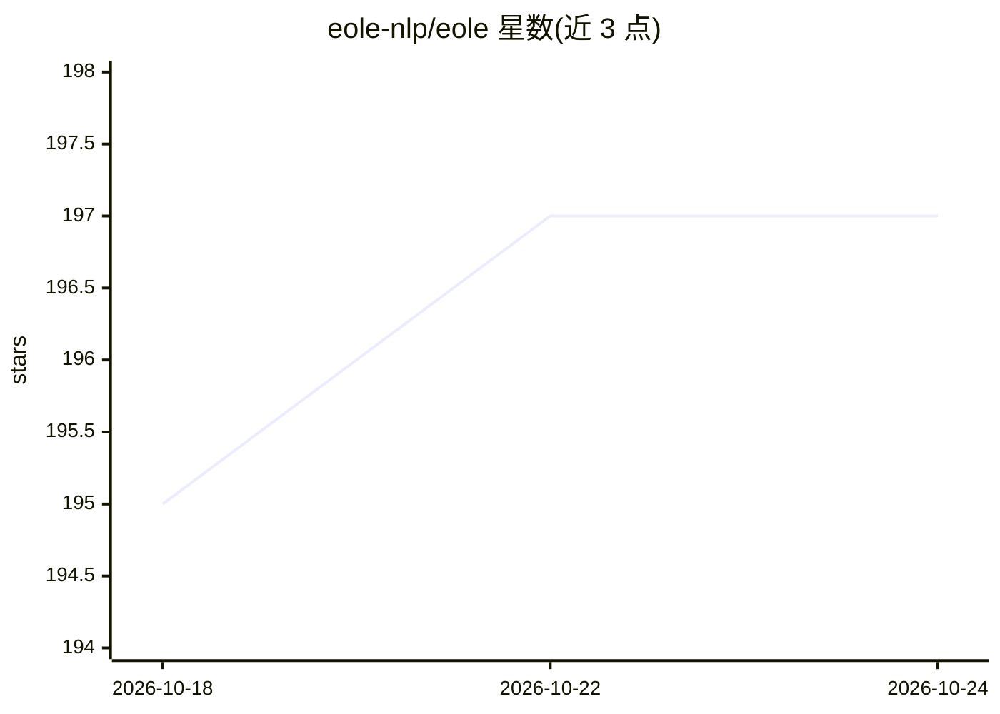

# eole-nlp/eole

⭐ 197 · Python · MIT · 推送 2026-10-23 · [GitHub](https://github.com/eole-nlp/eole) · [官网](https://eole-nlp.github.io/eole) · 组织维护

**给NLP研究者的开源语言建模工具箱：训练/微调/评测/推理一体化**

基于 PyTorch 的开源语言建模工具包，从 OpenNMT-py 分离而来，支持训练、微调、评测与部署 encoder、decoder 及 encoder-decoder 架构模型，覆盖机器翻译、语言生成、视觉/OCR、语音识别等任务。推理侧提供 FlashAttention KV 缓存、量化（含 MoE）、MTP 投机解码与 FastAPI 服务（OpenAI/Anthropic 风格端点），并带浏览器本地工作区（Chat/翻译/RAG/基准测试）。限制：需 Python≥3.11、CUDA 版 PyTorch，CUDA 扩展需编译，DPO/GRPO/PPO 为计划功能。

## 筛选速览

| 维度 | 判定 | 备注 |
|---|---|---|
| AI 角色 | `ai-ecosystem` | LLM/agent 周边工具 |
| 许可风险 | `permissive` | MIT |
| 部署形态 | `self-host` | docker 或自建部署 |
| 模型依赖 | — | README 未给出锁定关系 |
| 硬件要求 | — | 无带数字的原话,不猜 |
| 安装摩擦 | `low` | 无编译、无系统依赖或容器化 |
| 成熟度 | `idea` | |

## 能力要点

- 支持 Qwen/Gemma/Mistral/Llama 等 HF 模型族直接推理或转换
- 训练特性：LoRA、量化微调、张量并行、BF16、REINFORCE 奖励微调
- 推理特性：FlashAttention KV 缓存、CUDA/Triton 内核、MTP 投机解码、量化 MoE
- 内置浏览器工作区：Chat、翻译、OCR 文档、RAG 与 GPU 监控基准

## 适用场景

- 在自己的架构上训练或微调翻译/生成模型
- 本地或 RunPod GPU 上部署 Chat、翻译与 OCR 工作区
- 用 COMET/MetricX 等神经指标评测翻译质量

## 场景标签

`微调` `模型训练` `推理引擎` `模型评测` · 领域:评测与运维

## 证据(README 行号)

> L5: Eole is an open language modeling toolkit built on PyTorch, originally spun off
> L6: from OpenNMT-py. Train, fine-tune, evaluate, and serve encoder, decoder, and
> L7: encoder-decoder models in a compact, modular codebase built for experimentation.

## 星数曲线

2026-10-18 195 → 2026-10-24 197（+2）

---
*卡片 v1 · prompt 1.4 · 生成 2026-10-22 · 置信度 mid · 依据 README sha `596afa1d5314` · [字段定义](../../DATASET.md)*
