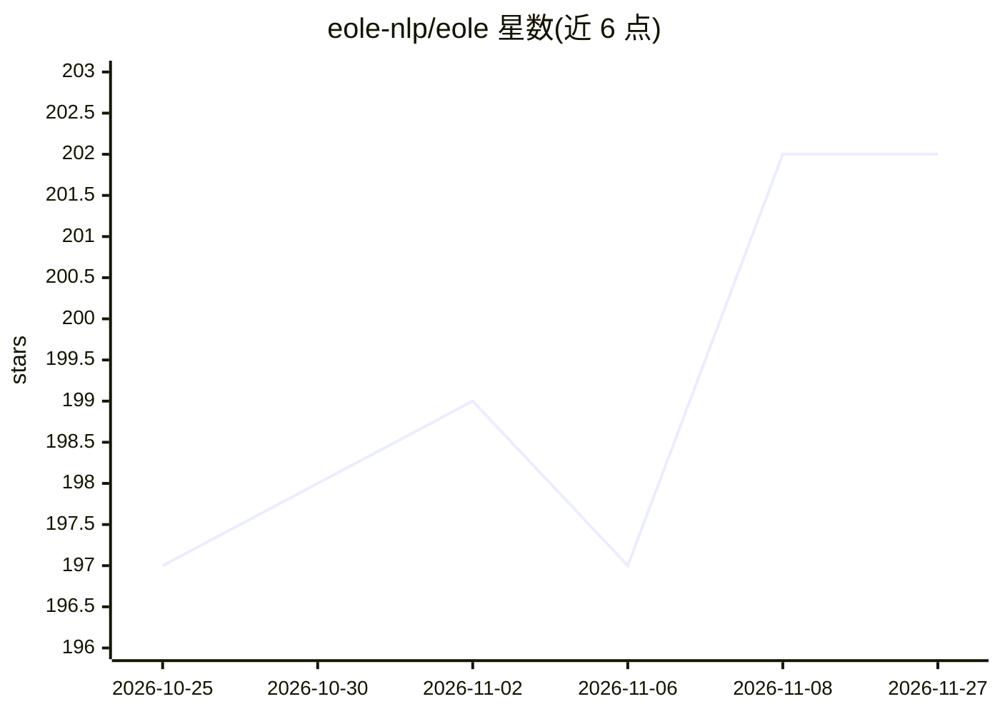

# eole-nlp/eole

⭐ 202 · Python · MIT · 推送 2026-11-26 · [GitHub](https://github.com/eole-nlp/eole) · [官网](https://eole-nlp.github.io/eole) · 组织维护

**基于 PyTorch 的语言建模工具包，供训练、微调与部署**

从 OpenNMT-py 衍生的开源语言建模工具包，覆盖训练、微调、评估与推理服务全流程，支持 encoder/decoder/encoder-decoder 架构。提供 LoRA 微调、REINFORCE 强化学习、BLEU/COMET/MetricX 等评估器、MTP 投机解码与 FP8 KV 缓存，并通过 FastAPI 服务暴露 OpenAI 与 Anthropic 风格 API。附带本地浏览器工作区，支持聊天、翻译、OCR 与 RAG。安装需 Python ≥3.11、CUDA 版 PyTorch 与 NVIDIA GPU，CUDA 扩展需本地编译。

## 筛选速览

| 维度 | 判定 | 备注 |
|---|---|---|
| AI 角色 | `ai-ecosystem` | LLM/agent 周边工具 |
| 许可风险 | `permissive` | MIT |
| 部署形态 | `self-host` | docker 或自建部署 |
| 模型依赖 | locked-api |  |
| 硬件要求 | — | 无带数字的原话,不猜 |
| 安装摩擦 | `low` | 无编译、无系统依赖或容器化 |
| 成熟度 | — | 结构信号不足 |

## 能力要点

- 训练/微调/评估/推理服务一体化，含 LoRA 与量化微调
- FastAPI 服务支持 OpenAI Chat/Responses 与 Anthropic Messages 格式
- MTP 与 DFlash2 投机解码、FP8 KV 缓存、MoE 专家缓存
- 本地浏览器工作区：聊天、翻译、OCR、RAG、监控与基准

## 适用场景

- 从零训练或微调 Transformer 翻译/语言模型
- 本地部署 Qwen 等模型并通过 API 提供服务
- 用 COMET/MetricX 等神经指标评估翻译质量
- 在浏览器里对本地文档做 OCR 与 RAG 问答

## 场景标签

`RAG` `OCR` `微调` `强化学习` · 领域:知识与检索

## 证据(README 行号)

> L5: Eole is an open language modeling toolkit built on PyTorch, originally spun off
> L6: from OpenNMT-py. Train, fine-tune, evaluate, and serve encoder, decoder, and
> L7: encoder-decoder models in a compact, modular codebase built for experimentation.

## 星数曲线

2026-10-25 197 → 2026-11-27 202（+5）

---
*卡片 v1 · prompt 1.4 · 生成 2026-11-26 · 置信度 high · 依据 README sha `aa29dbc8bdf1` · [字段定义](../../DATASET.md)*
