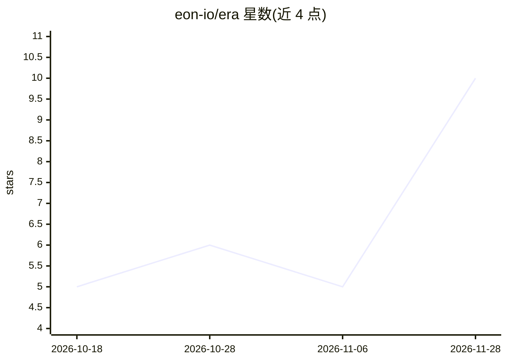

# eon-io/era

⭐ 10 · 推送 2026-10-04 · [GitHub](https://github.com/eon-io/era) · 组织维护

**为 agent 提供模拟合成企业数据的测试基准环境**

Era 按需生成一个完整且跨系统一致的合成公司——覆盖 Salesforce、Slack、Zendesk、Jira、Gong、共享盘等 61 类系统——并通过各厂商真实 REST API 形状和 MCP 端点对外服务。用户将 agent 指向该模拟企业进行开发、测试、演示与基准评测，每个系统有独立 URL 与凭据，环境可随实验或 CI 按需生成与销毁，全部数据为合成数据。提供 CLI 与 Web 控制台两种方式，附可运行示例（curl、MCP 客户端、多种 agent 框架、CI 工作流）。README 明确其不能替代带真实数据的预发环境。

## 筛选速览

| 维度 | 判定 | 备注 |
|---|---|---|
| AI 角色 | `ai-ecosystem` | LLM/agent 周边工具 |
| 许可风险 | `none` | — |
| 部署形态 | `None` |  |
| 模型依赖 | — | README 未给出锁定关系 |
| 硬件要求 | — | 无带数字的原话,不猜 |
| 安装摩擦 | `low` | 无编译、无系统依赖或容器化 |
| 成熟度 | — | 结构信号不足 |

## 能力要点

- 跨系统一致的合成企业数据（61 类系统），跨系统问题有确定答案
- 每个系统以厂商真实 REST API 形状提供，并全部暴露 MCP 端点
- 环境确定性生成、可随时销毁，适配 CI 每次运行
- 提供 CLI（era init/new/ls/rm 等）与 Web 控制台两种入口

## 适用场景

- 在设计伙伴数据到位前，用完整企业数据栈开发 agent
- 在 CI 中对每次测试运行生成确定性的合成公司并断言 agent 行为
- 为演示准备带历史记录的可信企业数据环境
- 以相同问题与基准真值对 agent 做可复现评测

## 场景标签

`模型评测` · 领域:评测与运维

## 证据(README 行号)

> L14: Era generates a complete, coherent, synthetic company on demand — its Salesforce
> L17: Point your agent at a full simulated enterprise to build, test, demo, and
> L31: - 🤖 **MCP everywhere.** Every system exposes an MCP endpoint, so any MCP-capable

## 星数曲线

2026-10-18 5 → 2026-11-28 10（+5）

---
*卡片 v1 · prompt 1.4 · 生成 2026-11-28 · 置信度 high · 依据 README sha `1c24091aadf8` · [字段定义](../../DATASET.md)*
