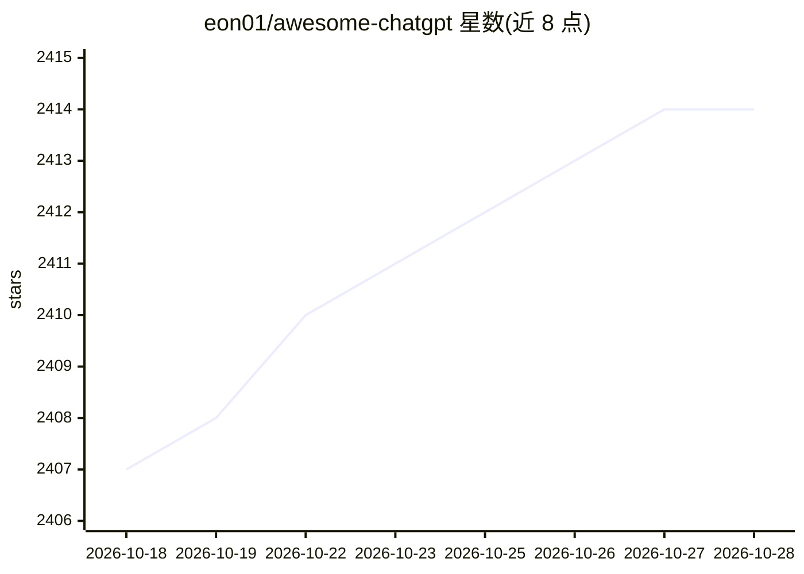

# eon01/awesome-chatgpt

⭐ 2,415 · NOASSERTION · 推送 2026-07-15 · [GitHub](https://github.com/eon01/awesome-chatgpt) · 个人维护

**ChatGPT 相关开源工具与资源策展清单**

由个人维护的 ChatGPT 生态资源聚合清单：收录官方资源，以及按 Python、JavaScript、Golang、Rust、Dart、Java 等十余种语言/平台组织的开发者库、SDK、API 封装，另含浏览器扩展、油猴脚本、书签脚本与终端/NeoVim/WhatsApp 集成等分类。收录规则限定开源、免费且与 ChatGPT/GPT 相关、面向开发者有用的资源。清单本身无安装与运行方式，通过条目链接跳转到各项目。

## 筛选速览

| 维度 | 判定 | 备注 |
|---|---|---|
| AI 角色 | `ai-knowledge` | 知识聚合/清单类 |
| 许可风险 | `none` | NOASSERTION |
| 部署形态 | `None` |  |
| 模型依赖 | — | README 未给出锁定关系 |
| 硬件要求 | — | 无带数字的原话,不猜 |
| 安装摩擦 | `low` | 无编译、无系统依赖或容器化 |
| 成熟度 | — | 结构信号不足 |

## 能力要点

- 覆盖 10+ 语言/平台的 ChatGPT SDK 与 API 封装条目
- 浏览器扩展、用户脚本、书签脚本分类收录
- 含终端、NeoVim、WhatsApp 等集成类工具
- 明确收录规则：仅限开源免费的开发者相关资源

## 适用场景

- 按编程语言查找 ChatGPT 的 SDK 或 API 客户端
- 寻找增强 ChatGPT 使用的浏览器扩展与用户脚本
- 了解 ChatGPT 周边开源工具的覆盖范围

## 场景标签

`精选清单` · 领域:学习与行业

## 证据(README 行号)

> L4:  A curated list of awesome ChatGPT resources, libraries, SDKs, APIs, and more.
> L38: **Note**: Only add **Open Source** and **free** resources/tools that are related to ChatGPT/GPT and that are useful

## 星数曲线

2026-10-18 2,407 → 2026-10-28 2,414（+7）

---
*卡片 v1 · prompt 1.4 · 生成 2026-10-21 · 置信度 high · 依据 README sha `a1077d266254` · [字段定义](../../DATASET.md)*
