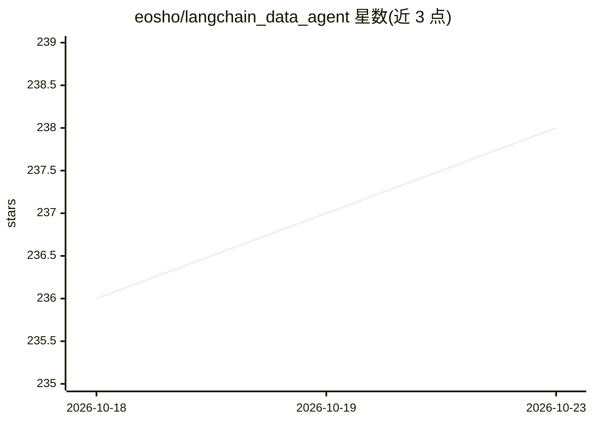

# eosho/langchain_data_agent

⭐ 238 · Python · MIT · 推送 2026-01-14 · [GitHub](https://github.com/eosho/langchain_data_agent) · 个人维护

**面向多数据库的 NL2SQL 智能体平台：英文提问生成 SQL 并执行**

基于 LangGraph 与 Azure OpenAI 构建的自然语言转 SQL 多智能体平台：意图检测将用户问题路由到对应数据智能体，生成 SQL 后经 sqlglot 跨方言校验再执行，带重试逻辑。支持 PostgreSQL、Azure SQL、Synapse、Cosmos DB、Databricks、BigQuery 等数据库及 Azure AD 认证，可通过任意 SQLAlchemy 兼容数据库连接。提供 CLI（单次查询/交互式聊天）、Chainlit Web UI 与 Python API 三种使用方式，YAML 配置数据源。依赖 Python 3.12+、uv 与 Azure OpenAI 部署。

## 筛选速览

| 维度 | 判定 | 备注 |
|---|---|---|
| AI 角色 | `ai-ecosystem` | LLM/agent 周边工具 |
| 许可风险 | `permissive` | MIT |
| 部署形态 | `None` |  |
| 模型依赖 | locked-api |  |
| 硬件要求 | — | 无带数字的原话,不猜 |
| 安装摩擦 | `low` | 无编译、无系统依赖或容器化 |
| 成熟度 | — | 结构信号不足 |

## 能力要点

- 意图检测自动路由问题到对应数据智能体
- sqlglot 跨方言 SQL 校验与重试执行
- 多轮对话上下文与自然语言生成图表
- A2A 协议支持与其他 A2A 系统互操作

## 适用场景

- 用英文提问直接查询企业数据库拿结果
- 为多个数据库配置一套统一的自然语言查询入口
- 对查询结果用自然语言生成图表

## 场景标签

`数据分析` · 领域:效率与自动化

## 证据(README 行号)

> L12: A natural language to SQL (NL2SQL) platform built on LangGraph and Azure OpenAI. This multi-agent system automatica
> L14: Built on top of LangChain's `SQLDatabase` with extended support for Azure AD authentication, Cosmos DB, and built-i

## 星数曲线

2026-10-18 236 → 2026-10-23 238（+2）

---
*卡片 v1 · prompt 1.4 · 生成 2026-10-22 · 置信度 high · 依据 README sha `a0cb09e3b4c7` · [字段定义](../../DATASET.md)*
