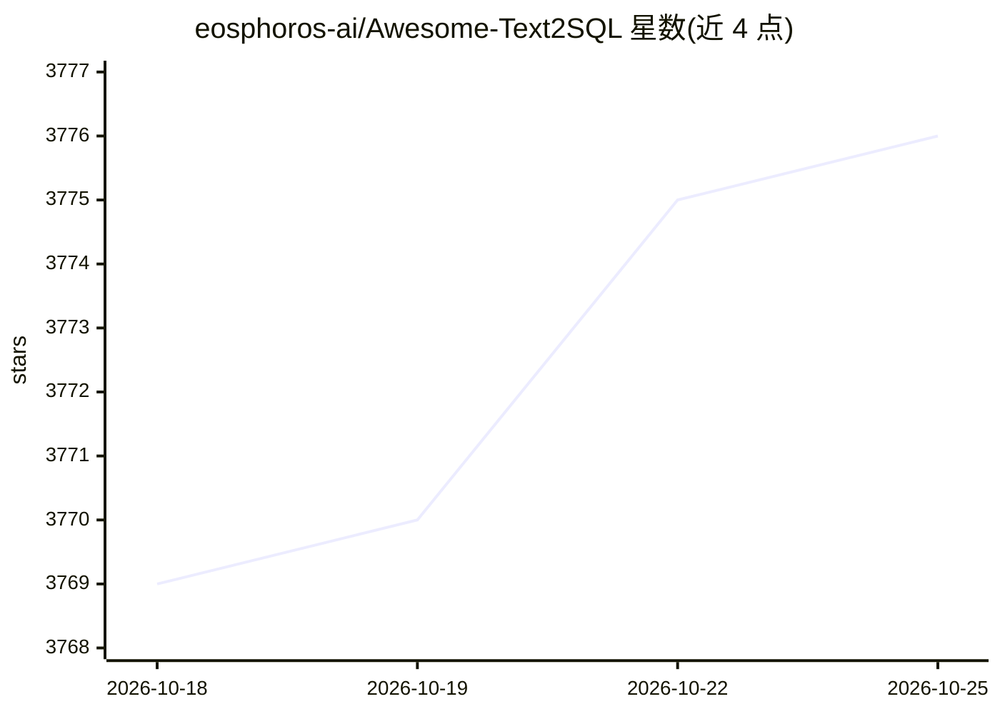

# eosphoros-ai/Awesome-Text2SQL

⭐ 3,777 · MIT · 推送 2026-01-26 · [GitHub](https://github.com/eosphoros-ai/Awesome-Text2SQL) · 组织维护 · 中文 README

**LLM+Text2SQL 论文与资源策展清单，含评测榜单**

由 eosphoros-ai 维护的 Text2SQL 主题资源清单：收录 Text2SQL/Text2DSL/Text2API/Text2Vis 方向的综述论文、经典模型（含论文与代码链接）、底座模型（Llama、ChatGLM、Baichuan 等）介绍，并提供 WikiSQL/Spider/BIRD 等基准的排行榜（按 EM/EX/R-VES 等指标列 Top10）。README 提供中英文版本与贡献指南，无安装运行形态，属于文献导航型仓库。

## 筛选速览

| 维度 | 判定 | 备注 |
|---|---|---|
| AI 角色 | `ai-knowledge` | 知识聚合/清单类 |
| 许可风险 | `permissive` | MIT |
| 部署形态 | `None` |  |
| 模型依赖 | — | README 未给出锁定关系 |
| 硬件要求 | — | 无带数字的原话,不猜 |
| 安装摩擦 | `low` | 无编译、无系统依赖或容器化 |
| 成熟度 | — | 结构信号不足 |

## 能力要点

- 收录数十篇 Text2SQL 综述与经典模型论文（附 paper/code 链接）
- 维护 WikiSQL/Spider/BIRD 多基准 Top10 排行榜
- 覆盖底座模型（Llama/ChatGLM/Baichuan 等）条目

## 适用场景

- 查找 Text2SQL 方向的综述与代表性论文
- 对比各方法在 Spider/BIRD 基准上的指标
- 了解可用的开源底座模型与微调资源

## 场景标签

`精选清单` `科研工具` · 领域:学习与行业

## 证据(README 行号)

> L11: Curated tutorials and resources for Large Language Models, Text2SQL, Text2DSL, Text2API, Text2Vis and more.
> L39: ## 📖 Survey

## 星数曲线

2026-10-18 3,769 → 2026-10-25 3,776（+7）

---
*卡片 v1 · prompt 1.4 · 生成 2026-10-21 · 置信度 high · 依据 README sha `3e1ba25ccdc9` · [字段定义](../../DATASET.md)*
