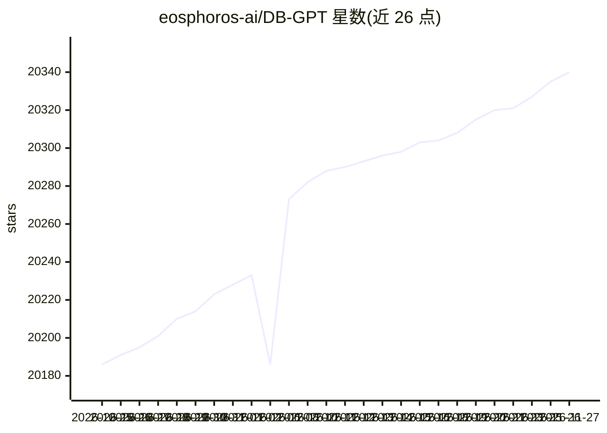

# eosphoros-ai/DB-GPT

⭐ 20,340 · Python · MIT · 推送 2026-11-25 · [GitHub](https://github.com/eosphoros-ai/DB-GPT) · [官网](http://docs.dbgpt.cn) · 组织维护 · 中文 README

**面向数据工作者的可控数据 Agent 平台**

DB-GPT 将数据连接、业务语义、专家技能、任务编排与分析产物整合到一个工作流中：用户以自然语言提问，经语义定义、专家插件与可视化工作流，执行 SQL/代码/检索，产出查询表、图表、分析报告与可编辑仪表盘。提供仪表盘、插件与技能、数据源管理（27 类数据库）、语义中心、工作流编排、知识库与定时任务六个模块，强调执行边界与人工审核。通过安装脚本或 PyPI 部署，Web 界面默认端口 5670。

## 筛选速览

| 维度 | 判定 | 备注 |
|---|---|---|
| AI 角色 | `ai-native` | 本体是模型或模型工具 |
| 许可风险 | `permissive` | MIT |
| 部署形态 | `library` | 以包/库形式分发 |
| 模型依赖 | — | README 未给出锁定关系 |
| 硬件要求 | — | 无带数字的原话,不猜 |
| 安装摩擦 | `low` | 无编译、无系统依赖或容器化 |
| 成熟度 | — | 结构信号不足 |

## 动量与使用信号

- 维护:`active` — 距上次 push 7.0 天,年发版 5,196 位贡献者
- 涨星:近 1 天 **+5**(自 20261016 起算)
- 安装:pypi 包 `dbgpt-app` 月下载 464
- 平台:— · 协议:OPENAI-API

## 能力要点

- 支持 MySQL、PostgreSQL、ClickHouse、DuckDB 等 27 类数据源连接
- 语义中心维护指标定义、公式与发布版本
- 可视化工作流编排 Agent 节点、串并行步骤
- 通过 MCP 服务集成外部工具连接器

## 适用场景

- 用自然语言查询业务数据库并生成分析报告
- 维护团队统一的指标口径与业务语义定义
- 构建可复用的数据分析工作流与仪表盘
- 通过知识库结合文档上下文做数据问答

## 场景标签

`数据分析` `RAG` `工作流自动化` · 领域:效率与自动化

## 证据(README 行号)

> L19: DB-GPT goes beyond translating natural language into SQL. It brings **data connections, business semantics, expert 
> L128: 4. Execute SQL, code, or retrieval within permitted tools and runtimes.

## 星数曲线

2026-10-25 20,186 → 2026-11-27 20,340（+154）

---
*卡片 v1 · prompt 1.4 · 生成 2026-11-26 · 置信度 high · 依据 README sha `d22f182148e5` · [字段定义](../../DATASET.md)*
