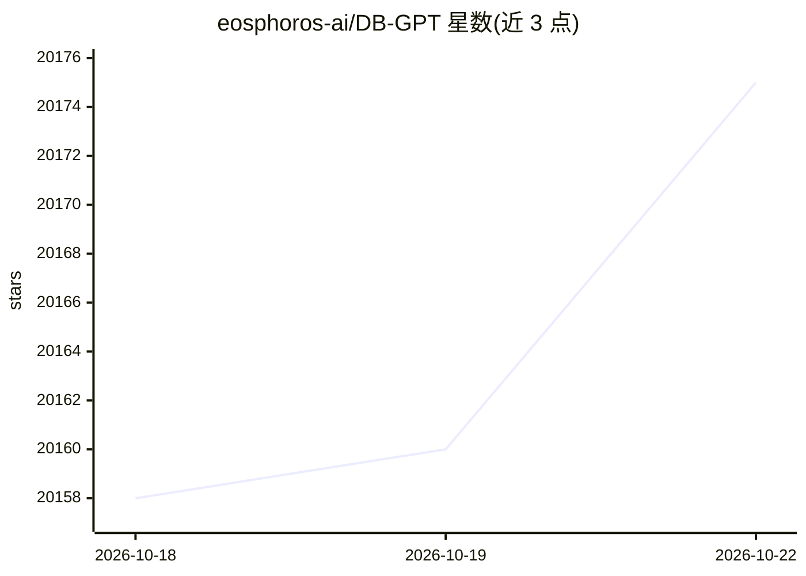

# eosphoros-ai/DB-GPT

⭐ 20,178 · Python · MIT · 推送 2026-10-22 · [GitHub](https://github.com/eosphoros-ai/DB-GPT) · [官网](http://docs.dbgpt.cn) · 组织维护 · 中文 README

**给开发者和企业的开源 Agent 式 AI 数据分析助手**

连接数据库、CSV/Excel、数仓与知识库，用自然语言驱动 AI 自动生成 SQL 与 Python 代码，在沙箱中执行分析并输出图表、仪表盘与 HTML 报告。平台层提供 Agent 编排、AWEL 工作流、RAG 与多模型接入；默认安装含 FastAPI、ChromaDB 向量库，首次运行有交互式配置向导。支持私有模型部署、代理脱敏与沙箱执行。以一行安装脚本、PyPI 包与 Docker 提供，Web 界面运行在 localhost:5670。

## 筛选速览

| 维度 | 判定 | 备注 |
|---|---|---|
| AI 角色 | `ai-native` | 本体是模型或模型工具 |
| 许可风险 | `permissive` | MIT |
| 部署形态 | `library` | 以包/库形式分发 |
| 模型依赖 | locked-api |  |
| 硬件要求 | — | 无带数字的原话,不猜 |
| 安装摩擦 | `low` | 无编译、无系统依赖或容器化 |
| 成熟度 | — | 结构信号不足 |

## 动量与使用信号

- 维护:`active` — 距上次 push 7.0 天,年发版 5,196 位贡献者
- 涨星:近 1 天 **+5**(自 20261016 起算)
- 安装:pypi 包 `dbgpt-app` 月下载 464
- 平台:— · 协议:OPENAI-API

## 能力要点

- 自然语言转 SQL 与 Python 代码的自主执行
- 可复用 skills 机制打包领域分析流程
- 沙箱化代码执行与可控工具调用
- Text2SQL 微调支持 LLaMA、Qwen、ChatGLM2 等 11 类模型

## 适用场景

- 连数据库用自然语言问数，自动生成 SQL 查询
- 分析 CSV/Excel 文件并生成可视化报告
- 为企业团队搭建 AI 原生数据助手应用
- 财务报告的代码化分析并输出图表与摘要

## 场景标签

`数据分析` `RAG` `Agent 框架` · 领域:Agent 开发

## 证据(README 行号)

> L43: > **An open-source AI data assistant that connects to your data, writes SQL and code, runs skills in sandboxed envi
> L59: DB-GPT is also a platform for building **AI-native data agents, workflows, and applications** with agents, AWEL, RA
> L191: The default installation includes the core framework (CLI, FastAPI, Agent), OpenAI-compatible LLM support, DashSco

## 星数曲线

2026-10-18 20,158 → 2026-10-22 20,175（+17）

---
*卡片 v1 · prompt 1.4 · 生成 2026-10-18 · 置信度 high · 依据 README sha `5c5a69338264` · [字段定义](../../DATASET.md)*
