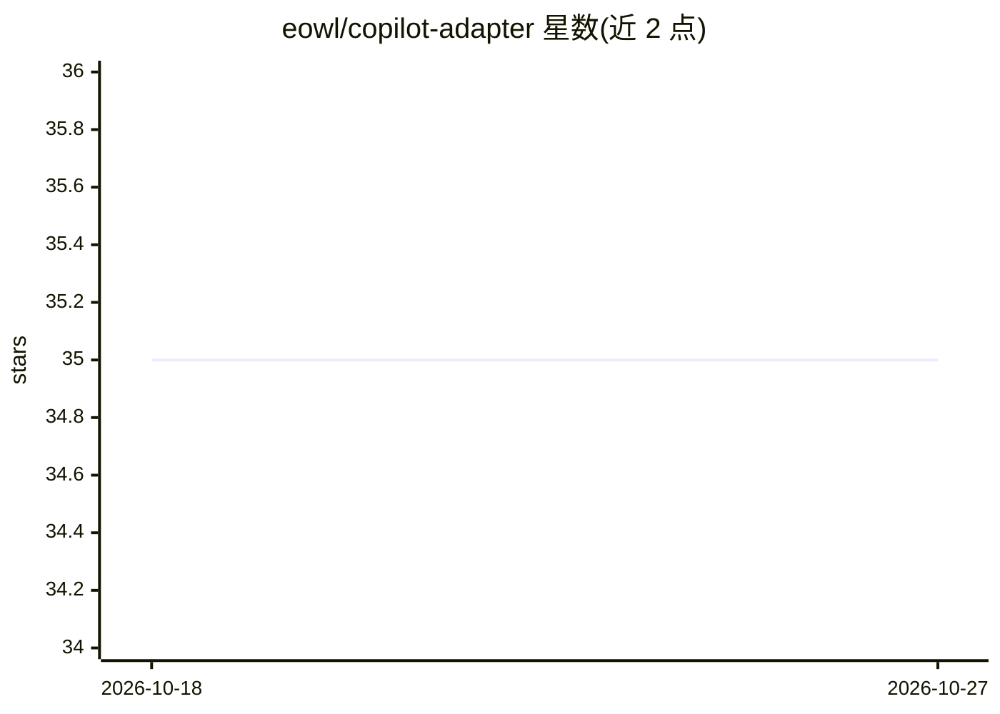

# eowl/copilot-adapter

⭐ 35 · TypeScript · MIT · 推送 2026-09-26 · [GitHub](https://github.com/eowl/copilot-adapter) · [官网](https://marketplace.visualstudio.com/items?itemName=Eowl.copilot-adapter) · 组织维护 · 中文 README

**让 VS Code Copilot Chat 接入第三方大模型（自带 API key）的扩展**

VS Code 扩展，将 DeepSeek、MiniMax、Kimi/Moonshot、Qwen、智谱 GLM、小米 MIMO、字节豆包等第三方模型接入原生 Copilot Chat 的模型选择器，使用用户自己的 API key，无需 Copilot 订阅或本地代理。机制包括：API key 存入 VS Code Secret Storage（操作系统凭据管理器）、纯文本模型经视觉代理处理图片、消息重排提升前缀缓存命中率、token 比率自动校准、自定义 OpenAI 兼容模型、余额/配额与单价显示。运行时零第三方依赖。

## 筛选速览

| 维度 | 判定 | 备注 |
|---|---|---|
| AI 角色 | `ai-ecosystem` | LLM/agent 周边工具 |
| 许可风险 | `permissive` | MIT |
| 部署形态 | `None` |  |
| 模型依赖 | locked-api |  |
| 硬件要求 | — | 无带数字的原话,不猜 |
| 安装摩擦 | `low` | 无编译、无系统依赖或容器化 |
| 成熟度 | — | 结构信号不足 |

## 能力要点

- 内置 8 家提供商的模型清单，模型选择器内直接切换
- API key 仅存于 VS Code Secret Storage，不落盘配置文件
- 视觉代理让纯文本模型处理图片附件
- 支持自定义 OpenAI 兼容模型、思考档位与缓存命中率日志

## 适用场景

- 用自购 DeepSeek/Qwen/GLM 等 API key 替代 Copilot 订阅使用 Copilot Chat
- 在 Copilot Chat 内为不同任务切换多家厂商的模型
- 为纯文本模型开启视觉代理以处理截图类输入

## 场景标签

`模型网关` · 领域:Agent 开发

## 证据(README 行号)

> L7: Extend VS Code's native Copilot Chat with third-party AI models. Switch between supported models directly from the C
> L33: 2. Open the **Language Models** panel, select a provider, and enter your API key — this is the native VS Code appro
> L34: 3. Open Copilot Chat, click the model selector, and choose a model.

## 星数曲线

2026-10-18 35 → 2026-10-27 35（+0）

---
*卡片 v1 · prompt 1.4 · 生成 2026-10-26 · 置信度 high · 依据 README sha `9e6b86c20219` · [字段定义](../../DATASET.md)*
